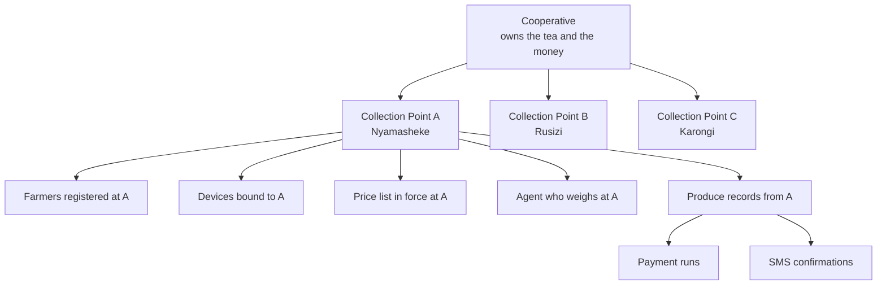
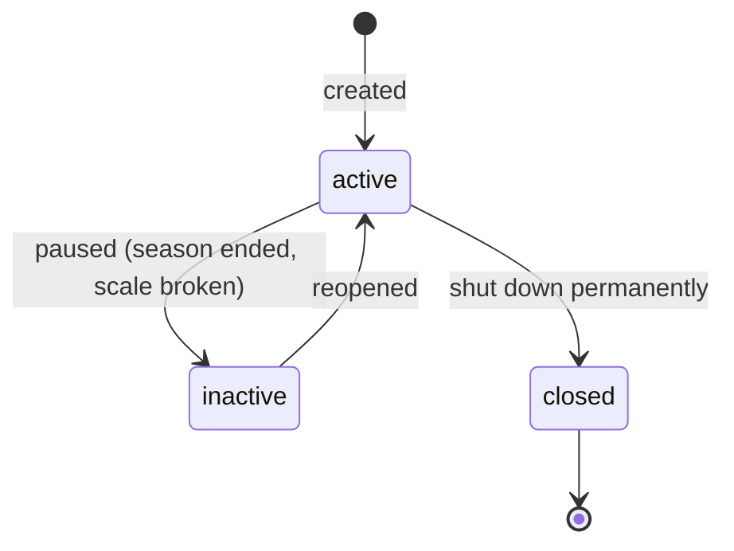
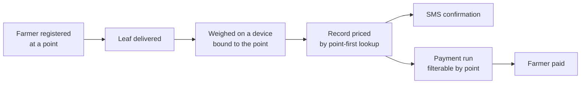

# :material-factory: Collection Points

A collection point is the physical place where a farmer's green leaf is weighed.
It sits between the cooperative that owns the tea and the farmer who grows it, and
it is the only place in Umucyo where a delivery officially begins.

<div class="at-a-glance" markdown>
**Who uses it:** the Cooperative Admin creates it, the Collection Point Agent works in it every day.

**What it does:** groups farmers, devices and price lists into one operational unit, and decides who is allowed to weigh what.

**Why it matters:** every record, payment and SMS in Umucyo is traceable back to exactly one collection point. If a record points at the wrong point, the farmer is paid from the wrong account.
</div>

## Why collection points exist at all

A cooperative is not one place. It is a head office plus a scatter of buying sheds, each with its own scale, its own agent, and its own farmers. Tea leaves must be delivered and weighed the same day they are picked, so the shed is where the real work happens.

Umucyo therefore treats the cooperative as a **container**, and the collection point as the **unit of work**:



Notice what the diagram says: farmers, devices, prices, agents, records, payments and SMS all hang off the collection point, not off the cooperative directly. That single design decision is what makes the rest of the system easy to reason about — and it is why this page comes before every other feature page.

## The operating model in one paragraph

Farmers grow and pick. They carry their leaf to a collection point. An agent weighs it on a device bound to that point. Umucyo stores the weight against the farmer, prices it against the price in force on that day, and later pays the farmer from the cooperative's account. Everything the system does afterwards — the SMS, the payment run, the USSD balance query — reads that one record. So the collection point is not a settings screen. It is the anchor of the whole delivery chain.

## Responsibilities of a collection point

| Responsibility | Owner | Enforced by |
| --- | --- | --- |
| Decide which farmers deliver here | Cooperative Admin | `farmer.collection_point_id` required |
| Decide which devices may weigh here | Cooperative Admin | device must be bound or weigh is rejected |
| Decide which price applies | Cooperative Admin | price list scoped to point, then cooperative |
| Decide who may operate the device | Cooperative Admin | inviter must be an admin of the cooperative |
| Keep the point open or close it | Cooperative Admin | `status` must be `active` to accept produce |
| Weigh and record honestly | Agent | one open session per device, agent cannot approve own payment |
| Reconcile daily totals | Cooperative Admin | daily summary per point |

Each row is a promise the software keeps. If a row is not true in production, it is a bug, not a limitation.

## Fields on a collection point

| Field | Type | Required | Notes |
| --- | --- | --- | --- |
| `id` | UUID | yes | generated server-side, never reused |
| `name` | string (3–80) | yes | unique inside the cooperative, e.g. `Nyamasheke Shed 2` |
| `cooperative_id` | UUID | yes | set from the admin's own account, never from the form |
| `code` | string (2–8, uppercase) | yes | short handle used on printed slips and in SMS, e.g. `NYA2` |
| `district` | string | yes | district in Rwanda, used for grouping in reports |
| `sector` | string | no | optional, helps agents find the shed |
| `latitude` | decimal(9,6) | no | optional; used later for maps |
| `longitude` | decimal(9,6) | no | optional |
| `status` | enum | yes | `active`, `inactive`, `closed`; default `active` |
| `opens_at` | time | no | shown to farmers on USSD |
| `closes_at` | time | no | shown to farmers on USSD |
| `created_by` | UUID | yes | the admin who created it, kept for audit |
| `created_at` | timestamp | yes | UTC |
| `updated_at` | timestamp | yes | UTC |

`code` deserves a note. It is short because it appears inside a 160-character SMS: `Umucyo: 12.4kg at NYA2 on 09/11. Q2 tea. Bal 348.2kg.` Without a code, that message needs the full point name and loses room for the balance.

## The three states



| State | Accepts new produce | Visible on USSD | Can be reopened |
| --- | --- | --- | --- |
| `active` | yes | yes | — |
| `inactive` | no | no | yes |
| `closed` | no | no | no |

`inactive` is the one people forget to use. When a shed's scale breaks for a week, the admin pauses it rather than deleting it, because deleting loses history. Produce records that already exist stay attached and stay payable.

`closed` is final. It exists for sheds that no longer operate at all. Records survive; the point simply stops accepting deliveries and disappears from pickers.

!!! warning "Never delete a collection point that has records"
    Umucyo blocks deletion when produce records exist against the point. Close it instead. Deleting would orphan payment history and break the audit trail the cooperative needs at the end of the season.

## Setting one up, step by step

1. **Check the cooperative exists.** The admin's account is already tied to a cooperative. If the cooperative is missing or wrong, stop — this is a setup bug, not something to fix by creating a new cooperative.
2. **Create the point.** Enter name, code, district. Choose a name a stranger could understand: `Nyamasheke Shed 2`, not `S2`.
3. **Set the hours.** Optional, but farmers see them on USSD, which removes a whole class of "is it open?" calls.
4. **Bind devices.** Add each scale that will operate at this shed. A device bound here can weigh here and nowhere else.
5. **Invite the agent.** The agent receives an SMS invitation, sets a password, and lands directly on the weighing screen for this point.
6. **Move or register farmers.** Existing farmers can be reassigned; new farmers choose the point during registration or are assigned by the admin.
7. **Confirm the price list.** Check that a price is in force for this point for today. If the point falls back to the cooperative price, say so out loud, because farmers will notice a different rate.
8. **Do a test delivery.** Weigh 1 kg, check the record, check the SMS, then delete the test record before the shed opens.

Only step 8 tells you the point is genuinely ready. Steps 1–7 configure; step 8 proves.

## Rules the system enforces

| # | Rule | Error code |
| --- | --- | --- |
| 1 | A point belongs to exactly one cooperative and cannot be moved between them | `409 COLLECTION_POINT_COOPERATIVE_IMMUTABLE` |
| 2 | `name` and `code` are unique inside their cooperative, case-insensitive | `409 COLLECTION_POINT_NAME_TAKEN` |
| 3 | A closed point cannot be reopened or reactivated | `409 COLLECTION_POINT_CLOSED` |
| 4 | Produce cannot be recorded against a non-active point | `409 COLLECTION_POINT_NOT_ACTIVE` |
| 5 | A point with produce records cannot be deleted | `409 COLLECTION_POINT_HAS_RECORDS` |
| 6 | A device may be bound to only one point at a time | `409 DEVICE_ALREADY_BOUND` |
| 7 | Only an admin of the owning cooperative may create, edit or close a point | `403 FORBIDDEN` |

Rule 6 is the one that bites in the field. Cooperatives do move a scale between sheds during harvest. Moving it is allowed — the device is unbound from the old point and bound to the new one in a single action, and the history of past weighings keeps pointing at the old point, which is correct.

## What each role can do

| Action | Cooperative Admin | Agent | Farmer | No account |
| --- | --- | --- | --- | --- |
| Create a point | yes | no | no | no |
| Edit name, hours, location | yes | no | no | no |
| Pause or reopen | yes | no | no | no |
| Close permanently | yes | no | no | no |
| View the point | yes | own point only | no | no |
| See the point on USSD | — | — | yes | yes |
| Bind a device | yes | no | no | no |
| Weigh produce here | no | yes | no | no |

## Where the collection point appears elsewhere

A newcomer should understand that this page is not isolated. The collection point shows up in at least six other places:

- **Registration** — a farmer must have one, and it defaults from the agent who registers them.
- **Weighing devices** — a device cannot weigh until it is bound to a point.
- **Produce records** — every record carries `collection_point_id`, copied at creation and never editable.
- **Tea pricing** — the price lookup goes point-first, cooperative-second.
- **Payments** — payment runs can be filtered by point, which is how a cooperative pays one shed's farmers at a time.
- **USSD** — the balance menu reports totals per point, so a farmer delivering to two sheds sees two lines.

Because of this, changing a point's name is safe (records reference the id), but changing its *meaning* — merging two sheds into one, or splitting one into two — is a data migration, not an edit. Ask before doing it.

## Edge cases and what should happen

| Situation | Expected behaviour |
| --- | --- |
| Admin creates a second point with the same name in a different cooperative | Allowed — uniqueness is per cooperative |
| Admin creates a point with `code` `nya2` when `NYA2` exists | Rejected, `409 COLLECTION_POINT_NAME_TAKEN` |
| Agent tries to weigh at a point they are not assigned to | Rejected, `403 FORBIDDEN`, and the attempt is logged |
| Device is moved to a new point mid-season | Allowed; past weighings keep the old point |
| Point paused while an agent has an open weighing session | Session is closed automatically; the agent is told to restart after reopening |
| Farmer delivers to a point they are not registered at | Rejected, `409 FARMER_NOT_AT_COLLECTION_POINT` |
| Point with 400 records is deleted by an admin | Blocked, `409 COLLECTION_POINT_HAS_RECORDS`; the UI offers "close instead" |
| Two admins create the same point at the same moment | Second request fails on the unique constraint; UI shows the existing point |
| Point is active but no price is in force | Weighing is blocked, `422 NO_ACTIVE_PRICE`; the admin must set a price first |

The last one is deliberate. Umucyo refuses to guess a price. Guessing would mean paying a farmer a number nobody chose.

## Common mistakes during setup

- **Skipping the code.** The point saves, but SMS messages look anonymous and agents cannot tell them apart.
- **Creating a point per agent.** Points are physical places. If two agents work one shed, both are assigned to the same point.
- **Using the head office as a collection point.** The office receives no leaf. It should have no point, or a `closed` one for historical records.
- **Renaming a point mid-season.** Allowed, but the printed slips and the SMS text change mid-stream and farmers call to ask why. Rename between seasons.
- **Forgetting to bind the device.** The shed opens, the farmer arrives, and the agent cannot weigh. This is the single most common first-day failure.

## Testing notes

Testing this feature means proving the seven rules above, not clicking around the form. A minimal but real set:

| Test | Expected |
| --- | --- |
| Create a valid point as admin | 201, appears in list, audit row written |
| Create as agent | 403, nothing written |
| Duplicate name, same cooperative | 409 |
| Duplicate name, different cooperative | 201 |
| Close a point, then try to reopen | 409 |
| Weigh at an inactive point | 409 `COLLECTION_POINT_NOT_ACTIVE` |
| Delete a point with one record | 409 |
| Bind the same device to two points | second attempt 409 |
| Pause a point with an open session | session closed, agent notified |

For each, check the side effects too: the audit log, the SMS that did or did not go out, and the daily summary.

## Related pages

- [Registration](registration.md) — how farmers and agents get attached to a point
- [Weighing Devices](weighing-devices.md) — binding a scale
- [Produce Records](produce-records.md) — where the point is copied onto every delivery
- [Tea Pricing](tea-pricing.md) — point-first, cooperative-second lookup
- [Payments](payments.md) — paying one shed at a time

## API reference for this feature

All endpoints require a bearer token. Admins act inside their own cooperative; the `cooperative_id` is read from the token and never from the request body.

### List points

```http
GET /api/v1/collection-points?status=active&district=Nyamasheke
Authorization: Bearer <token>
```

```json
{
  "data": [
    {
      "id": "6f1c0e6a-5c1e-4a1b-9a8e-2c7f5d1b8a01",
      "name": "Nyamasheke Shed 2",
      "code": "NYA2",
      "district": "Nyamasheke",
      "sector": "Bushekeri",
      "status": "active",
      "opens_at": "06:00",
      "closes_at": "11:30",
      "farmers_count": 148,
      "devices_count": 2,
      "today_kg": 412.6
    }
  ],
  "meta": { "page": 1, "per_page": 25, "total": 3 }
}
```

`today_kg` saves the admin from opening a report to answer the question everyone asks at 9 a.m.

### Create a point

```http
POST /api/v1/collection-points
Content-Type: application/json
```

```json
{
  "name": "Nyamasheke Shed 2",
  "code": "NYA2",
  "district": "Nyamasheke",
  "sector": "Bushekeri",
  "opens_at": "06:00",
  "closes_at": "11:30"
}
```

Returns `201` with the created object and its `id`.

### Update, pause, close

```http
PATCH /api/v1/collection-points/{id}      { "opens_at": "06:30" }
POST  /api/v1/collection-points/{id}/pause
POST  /api/v1/collection-points/{id}/reopen
POST  /api/v1/collection-points/{id}/close
```

`PATCH` cannot change `cooperative_id`, `created_by` or `created_at`. Attempting it returns `400 IMMUTABLE_FIELD`.

### Error responses

Every error uses the same envelope, so the frontend has one code path:

```json
{
  "error": {
    "code": "COLLECTION_POINT_NOT_ACTIVE",
    "message": "This collection point is paused and cannot accept produce.",
    "field": "collection_point_id",
    "correlation_id": "b41d9c7e"
  }
}
```

The `correlation_id` is echoed in the server log, which is how a support call turns into a five-second lookup instead of an hour.

## A day in the life

**05:40.** The agent arrives, opens the weighing screen on the PWA. The app shows the point name, the device status, and today's total so far (zero). The device pings green.

**06:05.** The first farmer arrives with 14 kg. The agent selects the farmer by name or phone, the device streams weights, the agent confirms. The screen shows `14.0 kg · NYA2 · RWF 3,200`. The record is written with the price copied at that moment — so an afternoon price change cannot rewrite the morning.

**06:06.** The farmer's phone buzzes: `Umucyo: 14.0kg at NYA2 on 09/11. Q2 tea. Bal 14.0kg this month.` She already knows the weight before she leaves the shed, which is the point.

**08:30.** The admin, at head office, opens the dashboard. Shed 2 shows 412.6 kg across 38 farmers. She can see which agent is active and whether any device has gone quiet.

**11:30.** The shed closes. The agent sees a day summary: farmers served, total kg, rejected readings. If anything looks wrong, this is the moment to flag it — before the payment run.

**That evening.** The payment run for the week includes Shed 2. Every record carries `collection_point_id`, so the run can be filtered, reviewed and paid shed by shed.

## Design decisions worth knowing

**The point is a place, not a person.** Two agents can work one shed across shifts. One agent can never work two sheds at the same time without being logged against the right one.

**The point is copied, not referenced, on some screens.** Reports store `collection_point_code` alongside the id so a closed point's history still reads correctly even if the name later changes.

**Devices bind to points, not to agents.** A scale belongs to a shed. Agents change; the scale stays.

**Closing is not deleting.** Rwanda's cooperative records must survive an audit cycle. A closed point keeps its history forever and simply stops appearing in pickers.

**Price lookup is point-first.** This allows two sheds in the same cooperative to pay different rates during different plucking seasons, which happens more often than head office expects.

## Frequently asked questions

**Can a farmer belong to two collection points?**
Not simultaneously. A farmer has one home point. Deliveries are recorded at that point. If a farmer genuinely delivers to two sheds, the admin assigns the home point and the exception is handled as a transfer — not by duplicating the farmer, which would double-count them in payments.

**What happens to farmers when a point closes?**
They keep their accounts and their records. The admin must reassign them to an active point before they can deliver again. The dashboard flags farmers left on a closed point.

**Can I change the code after printing slips?**
Technically yes, practically no. Slips, SMS and agent habits all reference it. Change codes between seasons.

**Do I need coordinates?**
No. They are optional and currently unused except for a map view. Skip them rather than entering guessed numbers.

**Why can't the agent create a collection point?**
Because a point decides who gets paid and from where. That is an administrative act, and Umucyo separates administrative acts from operational ones.

**What is the "daily summary" and where does it live?**
It is a derived view, computed from produce records for that point and date. It is not stored, so it cannot drift from the records. It appears on the dashboard and in the agent's end-of-day screen.

## Checklist before you call this feature done

- [ ] A point can be created, edited and paused by an admin
- [ ] A non-admin gets `403` and nothing is written
- [ ] Duplicate names are rejected inside a cooperative, allowed across cooperatives
- [ ] A closed point cannot be reopened or used
- [ ] Weighing at an inactive point fails with the right code
- [ ] A device cannot be bound to two points
- [ ] Deleting a point with records is blocked
- [ ] Farmers on a closed point are flagged on the dashboard
- [ ] The point appears correctly on USSD
- [ ] Payment runs can be filtered by point
- [ ] Audit rows are written for create, edit, pause, reopen and close

## Technical notes for developers

### Database shape

```sql
CREATE TABLE collection_points (
    id              UUID PRIMARY KEY DEFAULT gen_random_uuid(),
    cooperative_id  UUID NOT NULL REFERENCES cooperatives(id),
    name            TEXT NOT NULL,
    code            TEXT NOT NULL,
    district        TEXT NOT NULL,
    sector          TEXT,
    latitude        NUMERIC(9,6),
    longitude       NUMERIC(9,6),
    status          TEXT NOT NULL DEFAULT 'active'
                    CHECK (status IN ('active','inactive','closed')),
    opens_at        TIME,
    closes_at       TIME,
    created_by      UUID NOT NULL REFERENCES users(id),
    created_at      TIMESTAMPTZ NOT NULL DEFAULT now(),
    updated_at      TIMESTAMPTZ NOT NULL DEFAULT now()
);

CREATE UNIQUE INDEX uq_point_name
    ON collection_points (cooperative_id, lower(name));

CREATE UNIQUE INDEX uq_point_code
    ON collection_points (cooperative_id, upper(code));

CREATE INDEX ix_point_coop_status
    ON collection_points (cooperative_id, status);
```

Two details matter. Both unique indexes are **expression indexes** — `lower(name)` and `upper(code)` — because `NYA2` and `nya2` are the same shed, and a plain unique index would let both in. The composite index on `(cooperative_id, status)` is what keeps the dashboard fast once a cooperative has twenty points.

### Status guard

Every write that touches produce calls one function:

```python
def require_active_point(db, point_id: UUID, cooperative_id: UUID) -> CollectionPoint:
    point = db.get(CollectionPoint, point_id)
    if point is None or point.cooperative_id != cooperative_id:
        raise NotFound("COLLECTION_POINT_NOT_FOUND")
    if point.status != "active":
        raise Conflict("COLLECTION_POINT_NOT_ACTIVE")
    return point
```

Keeping this in one place means the rule cannot be half-implemented in one endpoint and forgotten in another. If a new endpoint forgets to call it, the test suite catches it — there is a test that walks every route tagged `writes_produce` and asserts the guard runs.

### Serialisation

`GET` returns a denormalised view: the raw row plus `farmers_count`, `devices_count` and `today_kg`. Those three are cheap aggregate subqueries:

```sql
SELECT
  p.*,
  (SELECT count(*) FROM farmers f WHERE f.collection_point_id = p.id) AS farmers_count,
  (SELECT count(*) FROM devices d WHERE d.collection_point_id = p.id AND d.status <> 'retired') AS devices_count,
  (SELECT coalesce(sum(pr.net_kg), 0) FROM produce_records pr
     WHERE pr.collection_point_id = p.id AND pr.recorded_on = current_date) AS today_kg
FROM collection_points p
WHERE p.cooperative_id = $1
ORDER BY p.name;
```

Do not add these to the list endpoint without the index on `produce_records (collection_point_id, recorded_on)`, or the dashboard slows to a crawl by mid-season.

### Audit

Every state change writes one row:

| Column | Example |
| --- | --- |
| `actor_id` | admin's user id |
| `action` | `collection_point.paused` |
| `entity` | `collection_points` |
| `entity_id` | the point id |
| `before` | `{"status":"active"}` |
| `after` | `{"status":"inactive"}` |
| `at` | timestamp, UTC |

Audit rows are append-only. There is no endpoint that updates or deletes them; if one ever appears in a pull request, it is a mistake.

### Performance expectations

| Operation | Target | Notes |
| --- | --- | --- |
| List points (20 points) | < 120 ms | including the three aggregates |
| Create point | < 200 ms | one insert plus one audit insert |
| Weigh check (guard call) | < 10 ms | primary-key lookup, cached for 30 s |

The guard's 30-second cache is safe because pausing a point also invalidates the cache key. Without invalidation, an agent could weigh for up to half a minute at a paused shed, which is exactly the bug this feature is meant to prevent.

## How this page fits the delivery loop



Remove collection points and this chain has nothing to hang on: a farmer would belong nowhere, a device would weigh anywhere, and a payment run could not be scoped. That is why this is the second page in the feature set and the first one a new developer should read after [Registration](registration.md).

## Glossary for this page

| Term | Meaning here |
| --- | --- |
| Cooperative | The legal entity that owns the tea and pays the farmers. Umucyo's tenant. |
| Collection point | A physical shed where leaf is weighed. The unit of work. |
| Code | A 2–8 character uppercase handle used in SMS and on slips. |
| Binding | The act of attaching a device to a point so it may weigh there. |
| Session | One continuous period during which a device is ready to weigh. |
| Net kg | Gross weight minus accepted deductions such as foreign matter. |
| Payment run | A batch that pays many farmers' records in one action. |
