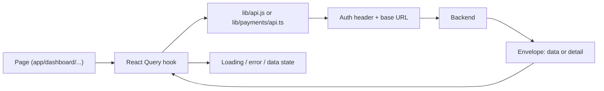

# :material-monitor-dashboard: Admin Dashboard

<div class="at-a-glance" markdown>

**In short:** the admin dashboard (`sulwe-dashboard`) is the web app cooperative administrators use to run the cooperative.

**Built with:** Next.js (App Router), React, Tailwind CSS, TanStack React Query

**Live:** [sulwe-dashboard.vercel.app](https://sulwe-dashboard.vercel.app/){ target="_blank" }

</div>

## Dashboard home


*The home page gives administrators an overview of their cooperative. Click the image to enlarge it.*

[:material-open-in-new: Open the live dashboard](https://sulwe-dashboard.vercel.app/){ .md-button .md-button--primary target="_blank" }

## What the dashboard is for

The dashboard is the office side of Umucyo. Farmers and collection agents never use it — they work through USSD and SMS. The dashboard is where the cooperative's staff do the four jobs that need a screen and a keyboard:

| Job | Where it happens | How often |
| --- | --- | --- |
| Registering farmers and agents | Farmers, Agents | Daily, at intake |
| Registering weighing devices and watching them | Weighing devices | At setup, then weekly |
| Setting the tea price and running payments | Tea pricing, Payments | Monthly cycle |
| Reading reports and fixing day-to-day problems | Reports, Deliveries | Daily |

Everything the dashboard does is a call to the backend in [Backend](backend.md). The dashboard stores no business data of its own, with one deliberate exception: the sign-in token, which lives in the browser so the administrator does not have to sign in on every page.

!!! note "The dashboard is not the source of truth"
    If a farmer says "my delivery is missing", the answer comes from the database, not from what the screen last showed. That is why every page has a refresh (see [Refreshing data](#refreshing-data)) and why the dashboard never edits a delivery's weight.

## Pages

| Page | Address |
| --- | --- |
| Landing | `/landing` |
| Sign in, Sign up | `/signin`, `/signup` |
| Login code | `/mfa` |
| Forgot password, Set password | `/forgot-password`, `/set-password` |
| Home | `/dashboard/home` |
| Farmers | `/dashboard/farmer` |
| Agents, Register an agent | `/dashboard/agent`, `/dashboard/register_agent` |
| Agent tasks | `/dashboard/agent-tasks` |
| Deliveries | `/dashboard/deliveries` |
| Weighing devices | `/dashboard/weighing-device` |
| Tea pricing | `/dashboard/tea-pricing` |
| Payments | `/dashboard/payments` |
| Reports | `/dashboard/reports` |
| Settings | `/dashboard/settings` |

## What each page does

### Signing in

`/signin` asks for an email address and password, then sends a one-time login code to that address. `/mfa` takes the code. The code is short-lived, so the page has a resend action with a short cooldown; the cooldown exists to stop an impatient administrator from burning through the provider's sending limit.

`/forgot-password` starts a reset, and `/set-password` finishes it. **Keep me logged in** on the sign-in page decides whether the token survives a browser restart.

!!! warning "One session per browser"
    Signing in on a second device does not sign out the first. If an administrator leaves a shared office machine signed in, sign out with the button in Settings rather than closing the tab — closing the tab keeps the token.

### Home

The landing page after sign-in. It shows the cooperative at a glance: recent deliveries, the current tea price, and anything that needs attention — a weighing device gone quiet, or a payment run that failed. It is a read-only page; every number links through to the page that owns it.

### Farmers and Agents

`/dashboard/farmer` lists farmers with search by name and phone number. A farmer record carries the collection point they belong to, which decides where their deliveries are expected to come from.

`/dashboard/agent` lists collection agents; `/dashboard/register_agent` creates one. Agents are the people who run weighing at a collection point, so registering one is really two steps: create the account, then attach it to a point.

| Field | Notes |
| --- | --- |
| Full name | As it appears on the cooperative register |
| Phone number | The number the USSD session and SMS use — one number, one farmer |
| Collection point | Decides where the agent works and which deliveries they see |
| Status | Active or inactive; an inactive agent cannot be assigned tasks |

### Agent tasks

`/dashboard/agent-tasks` shows work assigned to agents and its state — assigned, in progress, done. This is the screen that answers "has anyone weighed at that point today". Tasks also appear on the agent side as a list in the agent app; the dashboard only reads and assigns.

### Deliveries

`/dashboard/deliveries` is the ledger of what farmers brought to collection points. Each row comes from a weighing, so the weight shown is what the device recorded — a person cannot correct it here. Where a weight is wrong, the fix is at the device (re-tare and re-weigh), which leaves an audit trail instead of a silent edit.

The page filters by date, collection point and farmer, and shows the price that applied on the delivery date, not today's price. That distinction matters: a delivery made on the 3rd is paid at the 3rd's price even if the price changed on the 5th.

### Weighing devices

`/dashboard/weighing-device` lists registered devices with their last-seen time and status. A device that has not reported for a while is shown as **stale** rather than **offline**, because the dashboard only knows what the backend last heard.

Registering a device is a one-time pairing step. The device is identified by its serial number, and the pairing record is what lets the backend accept readings from it and reject everything else.

### Tea pricing

`/dashboard/tea-pricing` sets the price per kilogram for a period. The price is not a single number — it is a period with a start and an end date. Every delivery looks up the price that covers its date.

!!! danger "A price change does not rewrite history"
    Setting a new price from the 15th leaves deliveries before the 15th at the old price. If you set a price that overlaps an existing period, the backend refuses it. That refusal is deliberate — overlapping prices make "how much do we owe?" unanswerable.

If a price was entered wrongly, correct it in the same period rather than starting a new one, and only while no payment has been paid against it. Once a payment run has completed, the price is frozen.

### Payments

`/dashboard/payments` runs the monthly payment cycle. It is a **preview-then-commit** flow:

1. Choose a period and preview the run.
2. Read the preview: who will be paid, how much, and who is excluded.
3. Confirm, and the run is sent to the payment provider.

The preview is the whole point. It is the last moment a wrong price or a missing phone number is cheap to fix. Nothing is sent until the administrator confirms, and a completed run cannot be re-run for the same period — that protection is what stops a double payment.

| Button | What it does | Safe to click twice? |
| --- | --- | --- |
| Preview | Builds the run from deliveries and prices | Yes — reads only |
| Confirm | Sends the run to the provider | No — the backend rejects a repeat for the same period |
| Refresh status | Re-reads the provider's view of the run | Yes |

### Reports

`/dashboard/reports` turns deliveries and payments into the numbers the cooperative reports upward: kilos per collection point, per farmer, per month, and the money that went out. Reports are read-only and always derived from stored records, never typed in.

### Settings

`/dashboard/settings` holds the cooperative's own details and the signed-in administrator's account: name, contact details, and the sign-out action.

## Code layout

The dashboard lives in [`sulwe-dashboard`](https://github.com/akirachix/sulwe-dashboard).

| Path | Holds |
| --- | --- |
| `app/` | Routes: each folder with a `page.jsx` is one page |
| `app/dashboard/` | The signed-in pages listed above |
| `app/app-shell.jsx`, `app/layout.jsx` | The shared layout |
| `components/` | Shared parts: `payments/`, `reports/`, `sidebar/` |
| `components/Providers.jsx` | App-wide providers, such as React Query |
| `lib/api.js`, `lib/auth.ts` | Backend calls and sign-in helpers |
| `lib/payments/` | Payment API calls (`api.ts`), types and period helpers |
| `lib/reportsApi.ts`, `lib/reportTypes.ts`, `lib/reportLabels.ts` | Reports data |
| `lib/currency.ts` | Money formatting |
| `.husky/` | Pre-commit hook that runs ESLint and Prettier |
| `.github/` | GitHub Actions workflows |

### Where a change goes

| You want to… | Touch |
| --- | --- |
| Add a page | `app/dashboard/<name>/page.jsx` |
| Change a table or a form | `components/` (share it) or the page's own folder (keep it local) |
| Add a backend call | `lib/api.js`, or a named module in `lib/` if it has its own types |
| Change how money is shown | `lib/currency.ts` — never format money inline on a page |
| Change the layout or the sidebar | `app/app-shell.jsx`, `components/sidebar/` |
| Add a query or a mutation | The page, using the shared React Query client from `components/Providers.jsx` |

Two habits keep this listing honest. First, a component used by one page stays in that page's folder until a second page needs it — then it moves to `components/`. Second, nothing in `components/` imports from `app/dashboard/`, so the shared parts never depend on one screen.

## How it talks to the backend

- Every request goes through `lib/`, which adds the backend address and the `Authorization: Bearer` token.
- The token is kept in `localStorage` when **Keep me logged in** is selected.

### The request path



The rules that come out of that path:

1. **Pages never call `fetch` directly.** Every call goes through `lib/`, so the base URL and the token exist in one place. A page that builds its own URL will work locally and fail in production.
2. **A missing token means a redirect, not a blank page.** The guard sends the administrator to `/signin` and remembers where they were going.
3. **A `401` clears the token and signs out.** A `403` does not — it means "signed in, not allowed", and showing the sign-in page there would be confusing.
4. **Errors are shown, not swallowed.** Every query renders three states: loading, error with a retry, and data. An empty table and a failed request must never look the same.

### The token

| Question | Answer |
| --- | --- |
| Where is it stored? | `localStorage`, only when **Keep me logged in** is ticked |
| What is sent? | `Authorization: Bearer <token>` on every call |
| When does it expire? | Per the backend's token lifetime; an expired token returns `401` |
| What happens on sign out? | The token is removed and the cached queries are cleared |

!!! warning "`localStorage` is readable by any script on the page"
    That is acceptable for an internal admin tool with no third-party scripts, and it is written down here so nobody adds one later without thinking about it. Session storage would shrink the window but would also sign people out on every new tab.

### Refreshing data

React Query caches each query under a key — `deliveries`, with the filters included. Two consequences worth knowing:

- Navigating back to a page shows the cached result first, then refreshes. The screen is never blank while it re-fetches.
- After a mutation that changes records (confirming a payment, adding a farmer), the matching query is invalidated so the list re-reads. If a list looks stale after an action, the mutation is missing its invalidation, not the backend.

### Money and dates

Money arrives from the backend as an integer in the smallest unit. It is formatted for display in `lib/currency.ts` only, and shown in the cooperative's currency. Never do arithmetic in the view layer — the backend's numbers are the payable ones, and a client-side total that disagrees with a payment run only causes an argument.

Dates are stored in UTC and shown in the browser's time zone. A delivery dated "today" is resolved on the backend against the cooperative's local day, so an administrator travelling does not shift what counts as today.

## Building locally

```bash
git clone https://github.com/akirachix/sulwe-dashboard.git
cd sulwe-dashboard
npm install
cp .env.example .env.local        # then set the backend address
npm run dev
```

| Variable | Purpose |
| --- | --- |
| Backend base URL | Where `lib/api.js` sends requests |
| Any `NEXT_PUBLIC_*` value | Baked into the browser bundle at build time — changing one needs a restart of `npm run dev` and a rebuild on Vercel |

The app runs on `http://localhost:3000` by default. Point it at a local backend or at staging — never at production with live payment credentials.

## When something looks wrong

| Symptom | Likely cause | Fix |
| --- | --- | --- |
| Every page bounces to `/signin` | Token missing or expired | Sign in again; check the `Authorization` header in the network tab |
| Pages work locally, 404 in production | Backend URL hard-coded in a page instead of `lib/` | Route the call through `lib/api.js` |
| `401` on every call after a deploy | Token signed with an old `SECRET_KEY` | Sign in again; see [Configuration](configuration.md) |
| Empty table with no message | The error state is missing | Add the error branch; an empty list and a failure must not look alike |
| Money shows one decimal place | Formatted inline instead of `lib/currency.ts` | Use the shared formatter |
| Dashboard shows yesterday's payment status | Query cache not invalidated | Invalidate the payments query after confirm, or press refresh |
| Prices refuse to save | The period overlaps an existing one | Change the dates — see [Tea pricing](#tea-pricing) |

## A short checklist before a pull request

- [ ] Every backend call goes through `lib/`
- [ ] Loading, error and empty states all render
- [ ] Money uses `lib/currency.ts`; dates render in the browser's zone
- [ ] A `401` signs out, a `403` shows a permission message
- [ ] New pages are added to the sidebar and to the pages table above
- [ ] `npm run lint` and `npm run format` are clean — the pre-commit hook will run them anyway
- [ ] No secrets in `NEXT_PUBLIC_*`
