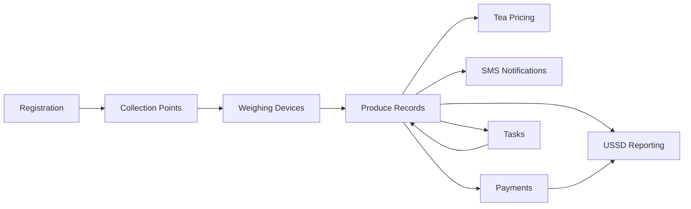

# :material-view-grid: Features

Umucyo is a tea value-chain traceability platform for cooperatives in Rwanda. It follows green leaf from the farmer's field to the collection point, through weighing and pricing, and out again to payments, SMS confirmations and USSD reporting. This page maps every feature, shows how they fit together, and tells you what to read first depending on your role.

**In short:** ten features cover registration, collection points, weighing, produce records, pricing, SMS, payments, USSD and tasks. Each one is a node in one delivery loop.

**Who uses it:** everyone — developers, testers, administrators, agents and farmers.

**Where:** this index, the navigation bar, and the home page.

## Why this exists

A Rwandan tea cooperative manages several collection points across districts such as Nyamasheke, Rusizi and Karongi. Farmers bring green leaf to their home point. Agents weigh it. The cooperative prices it, pays farmers through MTN MoMo in RWF, and keeps farmers informed by SMS and USSD. Without a single system, records live in notebooks, weights are not traceable to a scale, and payments are slow and easy to dispute.

Umucyo exists to make every step of that loop recorded, checkable and auditable. This page is the map.

## Where it sits in the delivery chain

## The ten features at a glance

| # | Feature | Icon | Primary role | Where it appears |
| --- | --- | :material-account-plus: | Create cooperative, admin, agent and farmer accounts | Admin dashboard, agent app, login pages |
| 2 | Collection points | :material-map-marker-radius: | Physical sheds where farmers deliver leaf | Admin dashboard → Settings |
| 3 | Weighing devices | :material-scale-balance: | Scales bound to a collection point | Admin dashboard, agent app |
| 4 | Produce records | :material-clipboard-list: | Each delivery: farmer, scale, weight, status, amount | Agent app → New delivery |
| 5 | Tea pricing | :material-tag: | Price per kilogram in force for a point on a day | Admin dashboard → Tea Pricing |
| 6 | SMS notifications | :material-message-text: | Automatic confirmation to the farmer | Backend, triggered by an accepted delivery |
| 7 | Payments | :material-cash-multiple: | Monthly payouts through MTN MoMo | Admin dashboard → Payments |
| 8 | USSD reporting | :material-cellphone-key: | Menu access from any basic phone | Any mobile phone, via Africa's Talking |
| 9 | Tasks | :material-checkbox-marked-circle: | Internal work items for admins and agents | Admin dashboard, agent app |

## Ownership table

| Asset | Owned by | Recorded in |
| --- | --- | --- |
| Cooperative | The cooperative itself | Registration |
| Collection points | The cooperative | Collection points |
| Weighing devices | The cooperative | Weighing devices |
| Tea prices | The cooperative | Tea pricing |
| Farmers | Agents | Registration |
| Agents | Administrators | Registration |
| Administrators | Bootstrap or another admin | Registration |
| Deliveries | Agents | Produce records |
| Payments | Administrators | Payments |
| Tasks | Administrators | Tasks |

## Reading order by role

**Developer or tester:** read this index, then `registration`, `collection-points`, `weighing-devices`, `produce-records`, `tea-pricing`, `sms-notifications`, `payments`, `ussd` and `tasks`. Finish with `security` and `configuration`.

**Administrator:** `registration`, `collection-points`, `tea-pricing`, `payments`, `tasks`.

**Agent:** `registration` (your own account), `weighing-devices`, `produce-records`, `sms-notifications`, `tasks`.

**Farmer:** you will not read these pages. You receive SMS messages and use the USSD menu.

## Requirement-to-feature mapping

| Business requirement | Feature(s) that satisfy it |
| --- | --- |
| Only registered users can use the system | Registration |
| Every weight is traceable to a scale | Weighing devices, produce records |
| Farmers know what was recorded | SMS notifications, USSD reporting |
| Payments match deliveries | Produce records, payments |
| Prices do not change mid-season | Tea pricing |
| Work is followed up | Tasks |
| Data from one point stays private | Collection points |

## Related pages

- [Registration](registration.md)
- [Collection points](collection-points.md)
- [Weighing devices](weighing-devices.md)
- [Produce records](produce-records.md)
- [Tea pricing](tea-pricing.md)
- [SMS notifications](sms-notifications.md)
- [Payments](payments.md)
- [USSD reporting](ussd.md)
- [Tasks management](tasks.md)