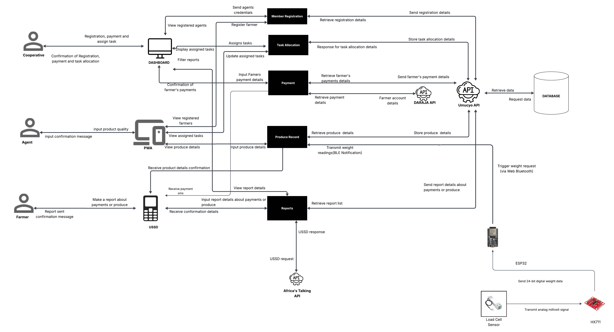
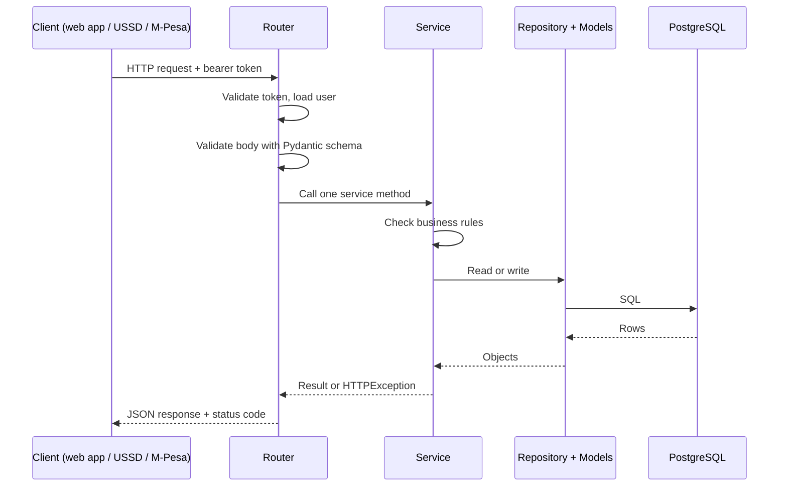
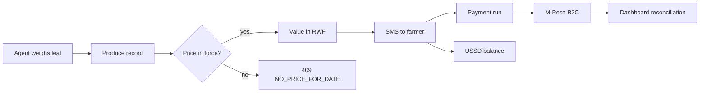

# Architecture

<div class="at-a-glance" markdown>

**In short:** one FastAPI backend holds all the logic and data. Both web apps and the farmers' phones go through it, and only the backend talks to M-Pesa, email, SMS and USSD services.

</div>

## System architecture



## Why it is built this way

Umucyo is used in two very different places. In the field, an agent stands in a
shed with a cheap Android phone, patchy 2G and a scale. At head office, a
cooperative administrator works on a laptop with fibre. A design that suits one
will hurt the other.

We chose one backend, one database and two thin web apps because:

- **Money and weights must agree.** A delivery entered in the field and a payment
  made at head office are the same record. Splitting them across services would
  mean reconciling two sources of truth, which is exactly the failure the
  cooperative is trying to escape.
- **The audit trail must be complete.** Every change to a produce record, a price
  or a payment run happens in one place, so it lands in one audit log.
- **The field is unreliable.** One deployment of one codebase is far easier to
  support over a flaky link than four services that must all be reachable.
- **The team is small.** A monolith that one developer can run locally with two
  commands is worth more than a diagram that impresses a reviewer.

This is a modular monolith, not a big ball of mud. Features are separated by
folders and by a strict router → service → repository flow, so any feature could
be lifted out later if it ever needed to be.

## The parts

| Part | Repository | Technology | Used by |
| --- | --- | --- | --- |
| Backend API | `sulwe-backend` | Python, FastAPI, PostgreSQL | Both web apps, USSD, M-Pesa callbacks |
| Admin dashboard | `sulwe-dashboard` | Next.js | Cooperative administrators |
| Agent app | `sulwe-frontend` | Next.js (installable web app) | Collection agents |
| Database | `sulwe-backend` | PostgreSQL 16 | Backend only |
| Docs site | `sulwe-technical-documentation` | MkDocs Material | The team, and the assessor |

Nothing but the backend ever opens a connection to PostgreSQL. The web apps know
the API URL and nothing else, which is why they can be rebuilt or replaced without
touching the data layer.

## How they connect

- The admin dashboard and the agent app call the backend's REST API, sending the
  signed-in user's bearer token with each request.
- Farmers reach the backend from a basic phone through the Africa's Talking USSD
  gateway.
- The backend stores everything in a PostgreSQL database.
- For payouts, the backend sends a B2C request to M-Pesa Daraja; Daraja later calls
  the backend's webhook with the result.
- The backend sends login codes and agent invitations by email, and delivery
  confirmations to farmers by SMS through SMS Leopard.

## The life of one request

Every call follows the same path, whether it comes from the dashboard, the agent
app, USSD or M-Pesa:



Three things are worth noticing in that diagram:

1. **Authentication happens before validation.** An anonymous caller never gets a
   validation error that leaks field names.
2. **The router does no thinking.** If you find an `if` in a router, it belongs in
   the service.
3. **Only the service raises business errors.** It raises `HTTPException` with a
   code the client can branch on, never a bare exception.

## Outside services

| Service | Used for | If it is down |
| --- | --- | --- |
| M-Pesa Daraja (Safaricom) | Paying farmers (B2C) | Payment runs stay `pending`; nothing is lost. Re-query before retrying |
| SMTP email | Login codes and agent invitations | Login is blocked for new sessions; existing tokens still work |
| SMS Leopard | Delivery SMS to farmers | The delivery is still saved. Message is queued and retried |
| Africa's Talking | USSD sessions | Farmers get the carrier's failure message. No data is written |

Two rules follow from that column, and both matter more than they look:

- **The core record never depends on a third party.** A delivery is saved whether or
  not the SMS goes out. A payment is recorded locally before Daraja is called.
- **Every outbound call is wrapped.** Timeouts are explicit, failures are logged with
  the record id, and retries are safe because the request carries an
  `Idempotency-Key` or a `client_reference`.

## Inside the backend

Each feature follows the same layers:

1. **Router:** declares the endpoint and calls one service method. No logic.
2. **Service:** checks the rules, does the work, and raises a clear HTTP error when
   something is not allowed.
3. **Repository and models:** read and write the database with SQLAlchemy.
4. **Schemas:** describe the request and response bodies with Pydantic.

```
sulwe-backend/
├── app/
│   ├── main.py                # app factory, middleware, router registration
│   ├── core/
│   │   ├── config.py          # settings loaded from environment
│   │   ├── security.py        # token creation, password hashing
│   │   └── errors.py          # error codes and the shared envelope
│   ├── db/
│   │   ├── session.py         # engine and session factory
│   │   └── base.py            # declarative base, mixins
│   └── modules/
│       ├── auth/              # router.py, service.py, models.py, schemas.py
│       ├── collection_points/
│       ├── farmers/
│       ├── devices/
│       ├── produce/
│       ├── pricing/
│       ├── payments/
│       ├── notifications/
│       ├── ussd/
│       └── tasks/
└── tests/
```

### A layer, written out

```python
# app/modules/collection_points/router.py
from fastapi import APIRouter, Depends
from app.modules.auth.deps import get_current_user
from app.modules.collection_points.schemas import PointCreate, PointRead
from app.modules.collection_points.service import CollectionPointService

router = APIRouter(prefix="/collection-points", tags=["collection-points"])

@router.post("", response_model=PointRead, status_code=201)
def create_point(
    body: PointCreate,
    service: CollectionPointService = Depends(),
    user=Depends(get_current_user),
):
    return service.create(body, actor=user)
```

```python
# app/modules/collection_points/service.py
from app.core.errors import Conflict

class CollectionPointService:
    def __init__(self, repo: CollectionPointRepository, db: Session):
        self.repo = repo
        self.db = db

    def create(self, body: PointCreate, actor) -> CollectionPoint:
        if self.repo.name_exists_in_cooperative(body.name, actor.cooperative_id):
            raise Conflict("COLLECTION_POINT_EXISTS", "This point name is already used.")
        if not self.repo.farmers_exist(body.assigned_farmer_ids, actor.cooperative_id):
            raise Conflict("FARMER_NOT_IN_COOPERATIVE", "One or more farmers are not in your cooperative.")
        point = self.repo.create(body, cooperative_id=actor.cooperative_id)
        self.db.commit()
        return point
```

### Rules that keep the layers honest

| Rule | Why it exists |
| --- | --- |
| Routers import services, never models | Keeps HTTP concerns out of the data layer |
| Services import repositories, never sessions directly | Makes services testable with a fake repository |
| Only services open or commit a transaction | One feature, one atomic unit |
| Schemas are per-feature, never shared | A shared schema becomes a change that breaks three features |
| Every service method takes the acting user | Permissions cannot be forgotten at the edges |
| A service never returns a raw model to a router | Responses are always validated by a schema |

## Data flow, joined up

The architecture only makes sense next to the delivery loop:



Each arrow is a separate feature page, and each runs in the backend. The agent app
touches the first two steps; the dashboard watches the last three; the farmer's
phone sees the SMS and the USSD screen. Nothing talks to anything except through
the backend.

## Environments

| Environment | Purpose | Database | Third parties |
| --- | --- | --- | --- |
| Local | Developer machine | Dockerised PostgreSQL | Mocked |
| Staging | Shared testing | Separate PostgreSQL instance | Sandbox credentials |
| Production | Live cooperative | Managed PostgreSQL | Live credentials |

The mocks are not optional decoration. Locally, SMS and payments are replaced by a
mock provider that writes to a log table, so a developer can run the entire
delivery loop — weigh, price, notify, pay — without spending a shilling or sending
a real message.

!!! warning "Never point staging at live credentials"
    A staging payment run with live Daraja credentials pays real farmers. The
    config loader refuses to start if `ENVIRONMENT=staging` and a live key is
    present.

## What this architecture does not have

Being explicit about gaps is part of the design:

- **No message queue.** Background work runs in-process. At cooperative scale
  (a few thousand deliveries a day) this is fine; it would not survive ten
  cooperatives.
- **No read replicas.** Reporting reads the primary. Queries are written with
  indexes rather than offloaded.
- **No separate notification service.** SMS is a module, not a worker fleet.
- **No horizontal autoscaling.** One instance, restartable, with a health check.
- **No cache layer.** Redis was considered and dropped: the read paths are cheap
  and a stale price cache would be a correctness bug, not a speed-up.

Each of those is a deliberate trade against a two-person team's support capacity.

## Non-functional targets

| Concern | Target | How it is met |
| --- | --- | --- |
| Read latency | p95 < 300 ms | Indexed lookups, pagination everywhere |
| Write latency | p95 < 500 ms | One transaction per request, no external call inside it |
| Payment run | 5,000 farmers < 10 min | Batched inserts, webhook-driven status |
| Availability | 99% monthly | Single instance, health check, fast restart |
| Data loss | Zero on committed records | `synchronous_commit=on`, nightly backup + WAL |
| Recovery point | ≤ 24 hours | Nightly `pg_dump` to offsite storage |

## Related pages

- [Backend](backend.md) — the layers in detail, with error handling
- [Database](database.md) — tables, constraints and indexes
- [API](api.md) — endpoints, envelope and error codes
- [Security](security.md) — authentication, roles and payment controls
- [Deployment](deployment.md) — environments, releases and rollback
