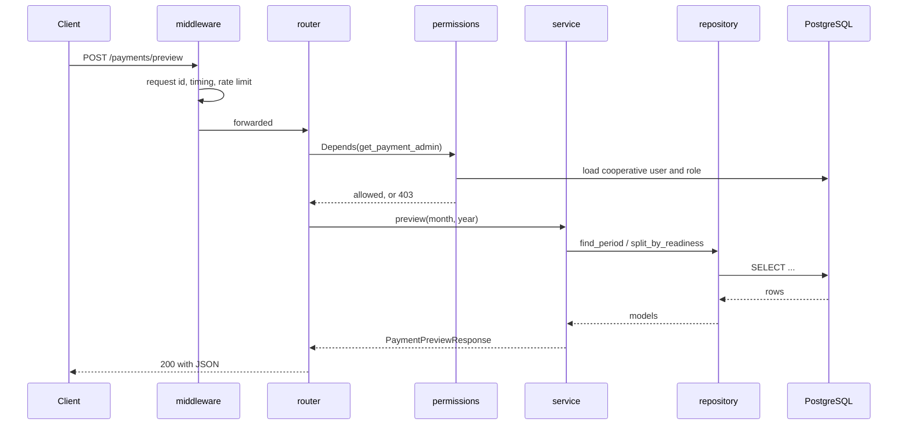

# Backend

<div class="at-a-glance" markdown>

**In short:** the backend (`sulwe-backend`) is a FastAPI application on PostgreSQL. Each feature follows the same layers, and every rule lives in a service, never in a router.

**Read this first if** you are adding an endpoint, fixing a rule, or you keep getting a `422` when you expected a `409` — the answer is almost always "that check belongs in the service, not the schema".

</div>

## Technology

| Tool | Version | Used for | Why this one |
| --- | --- | --- | --- |
| Python | 3.11 | The language | Type hints the whole way down; `match` and `\|` unions are usable |
| FastAPI | current | The web API | Request/response models are the documentation; the OpenAPI schema is generated, not written |
| SQLAlchemy | 2 | Database models and queries | Typed `select()` instead of string SQL, so a column rename breaks the build instead of production |
| Alembic | current | Database migrations | Every schema change is a reviewable file, not a hand-run `ALTER` |
| PostgreSQL | 15 | The database | Real constraints, partial unique indexes, and `numeric` — all three are load-bearing here |
| Pydantic | v2 | Request and response schemas | Rejects a bad payload before it reaches a service |
| uv | current | Packages and running commands | One lockfile, fast installs, same command in CI and locally |
| pytest | current | Tests | Fixtures make a seeded cooperative cheap to build per test |
| ruff | current | Linting and formatting (line length 130) | Lint and format in one tool, so there is nothing to argue about |

!!! note "One version rule"
    Python is pinned to 3.11 and everything else floats within its major version in `pyproject.toml`. The lockfile `uv.lock` is committed. If you install something new, commit the lockfile in the same commit — otherwise CI installs a different tree than you did.

## Project structure

The backend lives in [`sulwe-backend`](https://github.com/akirachix/sulwe-backend).

| Path | Holds |
| --- | --- |
| `main.py` | Creates the FastAPI app and registers the routers |
| `database.py` | Database connection and sessions |
| `middleware.py` | Request middleware |
| `core/` | Shared settings and helpers: `config.py`, `security.py`, `rate_limit.py`, `exceptions.py`, `utils.py` |
| `dependencies/permissions.py` | Role checks used by protected endpoints |
| `routers/` | Endpoints only: each one calls a single service method |
| `services/` | Business rules and validation |
| `repositories/` | Database reads and writes for each model |
| `models/` | SQLAlchemy tables, for example `farmer.py`, `produce_record.py`, `payment_transaction.py` |
| `schemas/` | Pydantic request and response shapes |
| `alembic/versions/` | Database migrations |
| `tests/` | The pytest suite |
| `Procfile` | Start command used by Heroku |
| `pyproject.toml` | Dependencies and tool settings |
| `.github/` | GitHub Actions workflows |

A request flows **router → service → repository → model → database**.

## The four layers

The same shape repeats for every feature. Learn it once and you can predict where any piece of code belongs.

| Layer | May do | May not do |
| --- | --- | --- |
| **Router** | Declare the route, read the current user, call one service method, return its result | Validate a business rule, open a transaction, touch the database |
| **Service** | Apply the rules, decide which error to raise, call one or more repositories, own the transaction | Build SQL by hand, know what a `Request` object is |
| **Repository** | Read and write rows, build queries, return models | Decide whether an operation is allowed |
| **Model** | Describe the table, its columns, its constraints and its relationships | Contain business logic that depends on who is asking |

### The router

A router contains only the route decorator, the function and **one** service call. No validation and no `try/except`.

```python
@router.post("/preview", response_model=PaymentPreviewResponse)
def preview_payments(
    payload: PaymentPreviewRequest,
    admin: CooperativeUser = Depends(get_payment_admin),
    service: PaymentService = Depends(get_payment_service),
):
    return service.preview(cooperative_user_id=admin.cooperative_user_id, month=payload.month, year=payload.year)
```

Three things to notice, because they are the review checklist:

1. `response_model` is set. The OpenAPI schema and the actual response cannot drift apart.
2. The permission check is a `Depends`, not an `if` inside the body. It appears in the generated docs as a security requirement.
3. The service is injected, not imported. That is what makes it patchable in a test.

### The service

The service is where a feature actually lives. It receives plain values, never the request, and it raises the error the caller deserves.

```python
class PaymentService:
    def __init__(self, repo: PaymentRepository, farmers: FarmerRepository):
        self.repo = repo
        self.farmers = farmers

    def preview(self, *, cooperative_user_id: UUID, month: int, year: int) -> PaymentPreviewResponse:
        period = self.repo.find_period(month=month, year=year, cooperative_id=cooperative_id)
        if period is None:
            raise HTTPException(status_code=404, detail="No payment period for that month")
        if period.status == "committed":
            raise HTTPException(status_code=409, detail="This month is already committed")

        ready, excluded = self.farmers.split_by_readiness(month=month, year=year)
        return PaymentPreviewResponse(ready=ready, excluded=excluded, total=sum(f.net for f in ready))
```

Rules for this layer:

- **One public method per use case.** `preview`, `commit`, `send`. If you need `preview_v2`, you have a change of behaviour and it should be visible in the route.
- **Raise, do not return, failures.** A service that returns `None` for "not found" forces every caller to remember to check it; one that raises cannot be forgotten.
- **Accept keyword arguments.** `preview(cooperative_user_id=..., month=..., year=...)` cannot be called with the arguments swapped, which is the most common bug in money code.
- **No session handling.** The session comes in through the repository; the service never calls `commit()` on its own except where a use case is explicitly transactional.

### The repository

Repositories turn questions into queries. They know the shape of the table; they know nothing about permission.

```python
class FarmerRepository:
    def __init__(self, session: Session):
        self.session = session

    def split_by_readiness(self, *, month: int, year: int):
        stmt = (
            select(ProduceRecord)
            .join(Farmer)
            .where(ProduceRecord.month == month, ProduceRecord.year == year)
            .where(ProduceRecord.price_per_kg.is_not(None))
        )
        records = self.session.scalars(stmt).all()
        ready = [r for r in records if r.farmer.momo_number]
        excluded = [r for r in records if not r.farmer.momo_number]
        return ready, excluded
```

- **Return models or plain tuples.** Not response schemas — that is the router's job.
- **One repository per aggregate.** `FarmerRepository`, not `EverythingRepository`.
- **Name methods after the question,** `find_active_by_device`, `count_unpaid_for_period`, so the query reads like the requirement.

### The model

Models describe the table. Constraints that must hold regardless of who writes — a unique produce record per farmer per day, a non-negative weight — belong here as database constraints, not only as Python checks.

```python
class ProduceRecord(Base):
    __tablename__ = "produce_records"

    id: Mapped[UUID] = mapped_column(primary_key=True, default=uuid4)
    farmer_id: Mapped[UUID] = mapped_column(ForeignKey("farmers.id"), index=True)
    weight_kg: Mapped[Decimal] = mapped_column(Numeric(10, 2))
    price_per_kg: Mapped[Decimal | None] = mapped_column(Numeric(10, 2), nullable=True)
    recorded_at: Mapped[datetime] = mapped_column(default=func.now)

    __table_args__ = (
        CheckConstraint("weight_kg > 0", name="ck_produce_weight_positive"),
        Index("uq_produce_farmer_day", farmer_id, func.date(recorded_at), unique=True),
    )
```

The two-layer rule: **the service gives the user a clear message, the database guarantees the rule.** If you only check in Python, a concurrent request or a data fix will eventually break it.

## The life of one request

A payment preview, followed end to end.



Failure branches you should be able to name without looking:

| Where it fails | What the client sees | Where the code is |
| --- | --- | --- |
| Bad JSON, wrong type, missing field | `422` with `field` | Pydantic schema |
| No token, expired token | `401` | `core/security.py` |
| Wrong role for this cooperative | `403` | `dependencies/permissions.py` |
| Month not found | `404` | service |
| Already committed | `409` | service |
| Too many requests | `429` | `core/rate_limit.py` |
| Anything unhandled | `500` with a request id, never a traceback | `core/exceptions.py` |

## Conventions

!!! success "Routers stay thin"
    A router contains only the route decorator, the function and **one** service call. No validation and no `try/except`.

    ```python
    @router.post("/preview", response_model=PaymentPreviewResponse)
    def preview_payments(
        payload: PaymentPreviewRequest,
        admin: CooperativeUser = Depends(get_payment_admin),
        service: PaymentService = Depends(get_payment_service),
    ):
        return service.preview(cooperative_user_id=admin.cooperative_user_id, month=payload.month, year=payload.year)
    ```

- **Services hold the rules.** They raise HTTP errors (`404`, `409` and so on) that FastAPI returns as they are.
- **Every database change is a migration,** committed with the code that needs it.
- **Secrets come from environment variables,** never from the code.

### Naming

| Thing | Convention | Example |
| --- | --- | --- |
| Table | plural snake_case | `produce_records` |
| Model class | singular PascalCase | `ProduceRecord` |
| Route | plural noun, verb only where needed | `/farmers`, `/payments/preview` |
| Service method | the use case, imperative | `preview`, `commit`, `send_monthly_report` |
| Schema | `<Thing>Request` / `<Thing>Response` | `PaymentPreviewRequest` |
| Error code | `SCREAMING_SNAKE` in `detail.code` | `NO_PRICE_FOR_DATE` |

### Money and weight

- Money is stored and returned as an **integer in RWF**. No floats, no cents.
- Weight is `Numeric(10, 2)`, kilograms, always positive.
- Rounding happens once, at the point of writing the payment — never in a preview and again at commit.

### Time

- Everything is stored in UTC. The cooperative's local date is derived, never stored twice.
- A "day" for produce records is the local day, which is why the unique index uses `date(recorded_at)` rather than a stored column.

## Errors and exceptions

`core/exceptions.py` registers two handlers:

| Handler | Catches | Returns |
| --- | --- | --- |
| `http_exception_handler` | `HTTPException` raised by a service | The same body, with `code` and `field` passed through `detail` |
| `unhandled_exception_handler` | Anything else | `500`, a short message, and the request id — the traceback goes to the logs only |

Rules:

- **Never leak internals.** A `psycopg` unique-violation message must not reach the client. Catch it, map it to `409 DUPLICATE_RECORD`, log the original.
- **Always include a code.** The dashboard switches on `detail.code`, not on the English sentence.
- **Include `field` when one field is at fault,** so the form can highlight it.

## Authentication and permissions

```python
def get_payment_admin(
    user: CooperativeUser = Depends(get_current_user),
) -> CooperativeUser:
    if user.role not in ("cooperative_admin", "super_admin"):
        raise HTTPException(status_code=403, detail="Payments are for admins")
    return user
```

- Permissions live in `dependencies/permissions.py`, one function per role rule, and are attached with `Depends`.
- A dependency either returns the user or raises. It never returns a boolean.
- Routes that cross a cooperative boundary filter by `cooperative_id` from the token, never from the request body.

## Transactions

The session is opened per request and closed by a dependency. A service that writes more than one row declares its own boundary:

```python
def commit(self, *, cooperative_user_id: UUID, month: int, year: int):
    with self.session.begin():            # one transaction for the whole run
        for row in ready:
            self.repo.insert_transaction(row)
        self.repo.mark_period_committed(month, year)
```

If anything inside raises, nothing is written — which is exactly what you want when a payment run half-fails.

## Migrations

```bash
uv run alembic revision --autogenerate -m "add momo_number to farmers"
uv run alembic upgrade head
uv run alembic heads          # must print exactly one head
```

- Autogenerate is a first draft. Read the file: Alembic misses `CheckConstraint` and expression indexes, and will happily drop a column you renamed.
- Never edit a migration that has already run on staging. Add a new one.
- Destructive changes go in two releases: stop writing to the column, then drop it.

## Background work

Two things happen off the request path:

| Job | Trigger | On failure |
| --- | --- | --- |
| SMS delivery | After produce record save, after price update | Retried three times, then marked `failed` and visible on the dashboard |
| Payment run | Manual commit by an admin | Rows are per-farmer, so a single failure does not roll back the batch |

Neither uses a queue yet. Both are started from the service and recorded in a table so the outcome survives a restart — the table is the queue.

## Configuration

All settings load through `core/config.py` with Pydantic `BaseSettings`, so a missing variable stops the app at boot instead of failing at 2 a.m.

```python
class Settings(BaseSettings):
    database_url: str
    jwt_secret: str
    momo_api_key: str = ""
    momo_mock: bool = True
    model_config = SettingsConfigDict(env_file=".env")
```

`momo_mock` defaults to `True`. It must be set to `False` explicitly, in the environment, by someone who means it.

## Logging

- One line per request: method, path, status, duration, request id.
- Errors log the traceback **and** the request id.
- No phone numbers or full names in logs — `farmer_id` instead. Logs get copied into chat windows; personal data does not belong in them.

## Tests

```
tests/
├── conftest.py             # app, session, seeded cooperative, tokens
├── test_farmers.py
├── test_produce_records.py
├── test_payments.py
├── test_prices.py
└── test_permissions.py     # 403s are tested as seriously as 200s
```

- One test file per feature, mirroring `services/`.
- Secrets and the MoMo client are patched in `conftest.py`; no test makes a network call.
- Each test names the rule it protects: `test_cannot_commit_twice`, `test_price_required_before_payment`.

## Useful commands

```bash
uv run fastapi dev            # start the server
uv run pytest -q              # run the tests
uv run ruff check .           # lint
uv run ruff format .          # format
uv run alembic heads          # check there is one migration head
uv run alembic upgrade head   # apply migrations
```

| Command | When |
| --- | --- |
| `uv sync` | After pulling a change to `pyproject.toml` or `uv.lock` |
| `uv run pytest -k payments -x` | One area, stop at the first failure |
| `uv run ruff check --fix .` | Before committing |
| `uv run alembic downgrade -1` | Undo the last migration locally only |

## Folder structure

The backend lives in [`sulwe-backend`](https://github.com/akirachix/sulwe-backend).

```text
sulwe-backend/
├── .github/              # GitHub Actions workflows
├── alembic/
│   ├── versions/         # Database migrations
│   └── env.py
├── core/                 # Shared settings and helpers
│   ├── config.py
│   ├── exceptions.py
│   ├── rate_limit.py
│   ├── security.py
│   └── utils.py
├── dependencies/
│   └── permissions.py    # Role checks for protected endpoints
├── models/               # SQLAlchemy tables
│   ├── agent_assignment.py
│   ├── audit_log.py
│   ├── collection_point.py
│   ├── cooperative.py
│   ├── cooperative_user.py
│   ├── farmer.py
│   ├── payment_report.py
│   ├── payment_transaction.py
│   ├── produce_price.py
│   ├── produce_record.py
│   ├── task.py
│   ├── user.py
│   └── weighing_device.py
├── repositories/         # Database reads and writes
├── routers/              # API endpoints
├── schemas/              # Request and response shapes
├── services/             # Business rules and validation
├── tests/                # pytest suite
├── alembic.ini
├── database.py           # Database connection
├── main.py               # Creates the FastAPI app
├── middleware.py
├── Procfile              # Start command used by Heroku
└── pyproject.toml        # Dependencies and tool settings
```

A request flows **router → service → repository → model → database**.

## Before you open a pull request

- [ ] New rule is in a service, not a router, and raises an error with a `code`
- [ ] New column has a migration, and `alembic heads` still prints one head
- [ ] Constraint that must always hold lives in the database too
- [ ] Permission is a `Depends`, and a test proves the `403`
- [ ] Money is an integer in RWF; weight is `Numeric(10, 2)`
- [ ] No secret, phone number or full name in code or logs
- [ ] `ruff check .` and `pytest -q` pass locally

## Related pages

- [Architecture](architecture.md) — where this service sits and what it talks to
- [Database](database.md) — the tables these models mirror
- [API](api.md) — the routes these routers expose
- [Security](security.md) — the role model behind the permission dependencies
