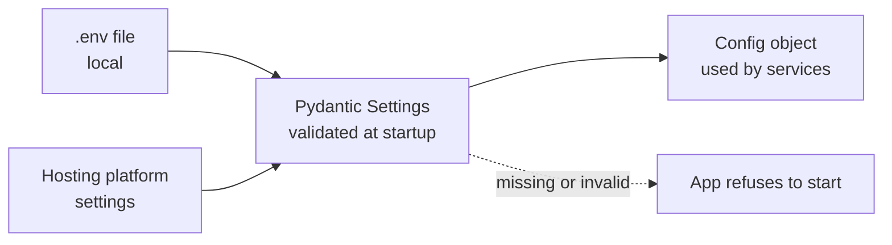

# Configuration

<div class="at-a-glance" markdown>

**In short:** every setting comes from an environment variable: `.env` for the backend, `.env.local` for the web apps, or the hosting platform's settings in production.

**Why it matters:** nothing in the code holds a password, a key or an address. The same build runs locally and in production; only the environment changes.

</div>

!!! danger "Never commit values"
    `.env` and `.env.local` contain passwords and keys. They are listed in `.gitignore` and must never be committed, pasted in chats or shown in screenshots.

---

## How configuration is loaded



Four rules follow from this.

1. **Read once, at startup.** Settings are parsed into a typed object when the process boots. Code never calls `os.getenv` deep inside a service.
2. **Fail fast.** A missing `SECRET_KEY` or a malformed `DATABASE_URL` stops the app with a clear message, instead of failing hours later on a farmer's first login.
3. **Defaults are for development only.** Every default in the table below is a safe local value. Production must set the real one.
4. **Nothing secret reaches the browser.** Only variables prefixed `NEXT_PUBLIC_` are exposed to client code in the Next.js apps. Everything else stays on the server.

---

## The three files

| File | Used by | Committed? | Purpose |
| --- | --- | --- | --- |
| `.env.example` | Everyone | **Yes** | The list of variables with placeholder values. Copied to `.env` |
| `.env` | FastAPI backend | No | Real local values |
| `.env.local` | Admin dashboard, agent app | No | Real local values, one file per app |
| `.env.test` | Test suite | Yes | Throwaway values, a test database URL, mocked SMS and payments |

!!! tip "Starting locally"
    ```bash
    cp .env.example .env          # backend
    cp .env.example .env.local    # each Next.js app
    ```
    Then fill in the values. If a variable is new, add it to `.env.example` in the same pull request that uses it, otherwise the next developer hits a confusing startup error.

---

## Backend

=== "App and database"

    | Variable | Purpose | Required | Local default |
    | --- | --- | --- | --- |
    | `DATABASE_URL` | PostgreSQL connection | Yes | `postgresql://localhost:5432/umucyo` |
    | `APP_NAME` | Shown in API docs and log lines | No | `Umucyo` |
    | `APP_ENV` | `local`, `staging` or `production` | No | `local` |
    | `DEBUG` | Verbose errors and SQL logging | No | `true` locally, `false` always in production |
    | `FRONTEND_URL` | Base address used in links inside emails | Yes | `http://localhost:3000` |
    | `CORS_ALLOWED_ORIGINS` | Web app addresses allowed to call the API, comma-separated | Yes | `http://localhost:3000,http://localhost:3001` |
    | `BOOTSTRAP_SECRET` | Secret needed to create the first administrator | Yes, first run only | Random string |

    !!! warning "`DEBUG=true` in production"
        It returns stack traces and SQL to the caller. Set it to `false` and confirm the value on the hosting platform, not just in your local file.

    `CORS_ALLOWED_ORIGINS` must list exact origins, including the scheme and port. A wildcard `*` is refused when credentials are allowed, which is why it is a list rather than a flag.

=== "Login and email"

    | Variable | Purpose | Required | Local default |
    | --- | --- | --- | --- |
    | `SECRET_KEY` | Signs login tokens | Yes | Any long random string |
    | `JWT_SECRET_KEY`, `JWT_ALGORITHM` | Optional token overrides | No | Falls back to `SECRET_KEY`, `HS256` |
    | `ACCESS_TOKEN_EXPIRE_MINUTES` | Token lifetime | No | `30` |
    | `OTP_EXPIRE_MINUTES` | Login code lifetime | No | `10` |
    | `PASSWORD_SETUP_EXPIRE_HOURS` | Agent invitation lifetime | No | `24` |
    | `SMTP_HOST`, `SMTP_PORT` | Email server | No | Gmail, `587` |
    | `SMTP_EMAIL` | Account that authenticates | No | — |
    | `SMTP_FROM_EMAIL` | Address shown to recipients | No | Same as `SMTP_EMAIL` |
    | `SMTP_PASSWORD` | Sending account password; for Gmail, an app password | No | — |

    **`SECRET_KEY` is the one that must never change casually.** Rotating it signs every user out instantly, because existing tokens no longer verify. Rotate it only when you believe it has leaked, and expect the logout.

    Generate a strong value:

    ```bash
    python -c "import secrets; print(secrets.token_urlsafe(48))"
    ```

    !!! note "Gmail app passwords"
        A normal Gmail password will not work once two-step verification is on. Create an app password in the Google account settings and use that as `SMTP_PASSWORD`.

=== "SMS"

    | Variable | Purpose | Required |
    | --- | --- | --- |
    | `SMS_LEOPARD_API_KEY` | SMS Leopard key | Yes |
    | `SMS_LEOPARD_API_SECRET` | SMS Leopard secret | Yes |
    | `SMS_LEOPARD_SENDER_ID` | Sender name farmers see | Yes |

    The sender ID is what appears on a farmer's handset. It should match the name the cooperative uses in the field, so a message is not mistaken for a scam. Use the same ID in staging so test messages look identical to real ones.

    When the credentials are absent in local development, SMS sending is skipped and the message is written to the log instead of being charged for.

=== "Payments"

    | Variable | Purpose | Local default |
    | --- | --- | --- |
    | `PAYMENT_CURRENCY`, `DARAJA_CURRENCY` | Both `KES` | `KES` |
    | `DARAJA_ENVIRONMENT` | `sandbox` (production is refused) | `sandbox` |
    | `DARAJA_SUBMISSION_MODE` | `mock` or `sandbox` | `mock` |
    | `DARAJA_ALLOW_SANDBOX_SUBMISSIONS` | `true` to allow sandbox sends | `false` |
    | `DARAJA_CONSUMER_KEY`, `DARAJA_CONSUMER_SECRET` | Daraja app credentials | — |
    | `DARAJA_SHORTCODE` | B2C short code | — |
    | `DARAJA_INITIATOR_NAME`, `DARAJA_INITIATOR_PASSWORD` | B2C account details | — |
    | `DARAJA_SECURITY_CERTIFICATE` | Safaricom's certificate | — |
    | `DARAJA_CALLBACK_TOKEN` | Secret in the callback URLs (32+ characters) | Random string |
    | `DARAJA_RESULT_URL`, `DARAJA_TIMEOUT_URL` | Public HTTPS webhook addresses ending in `?token=` | — |

    **Two switches protect real money.**

    - `DARAJA_SUBMISSION_MODE=mock` never calls the provider. Use it locally and in tests.
    - `DARAJA_ALLOW_SANDBOX_SUBMISSIONS=false` blocks even sandbox sends. Leave it `false` unless you are deliberately testing the request path.

    The callback token is checked on every webhook. A request without the right `?token=` is rejected before any record changes, which is what stops a stranger posting a fake "paid" result.

    ```bash
    python -c "import secrets; print(secrets.token_urlsafe(32))"
    ```

    !!! warning "Currency is a deployment decision, not a code change"
        These variables are named for Daraja and default to `KES`. If a deployment moves to another market and provider, this is the whole list to review — currency names, credentials, callback paths and the security certificate — plus the currency label shown in the dashboard. Change them as a set, never one at a time.

---

## Admin dashboard

| Variable | Purpose | Example |
| --- | --- | --- |
| `NEXT_PUBLIC_API_URL` | Backend address | `https://your-backend` |
| `NEXT_PUBLIC_PAYMENTS_API_URL` | Payments API, the backend address plus `/api/payments` | `https://your-backend/api/payments` |
| `NEXT_PUBLIC_AGENT_APP_URL` | Agent app address, where agents are sent after login | `https://your-agent-app` |

!!! tip "Changing a `NEXT_PUBLIC_` value"
    These values are built into the app. Restart `npm run dev` locally, and redeploy the hosted app after changing them.

Because they are compiled in, a `NEXT_PUBLIC_` variable is **not secret**. Anything put there is readable by anyone who opens the browser's developer tools. Keys belong in the backend.

---

## Agent app

| Variable | Purpose | Example |
| --- | --- | --- |
| `NEXT_PUBLIC_API_URL` | Backend address | `https://your-backend` |

The agent app talks to the same API as the dashboard. It has no payments configuration of its own; payments are triggered from the dashboard and recorded by the backend.

---

## Per-environment checklist

| Setting | Local | Staging | Production |
| --- | --- | --- | --- |
| `DEBUG` | `true` | `false` | `false` |
| `SECRET_KEY` | Any string | Long random, different from production | Long random, stored in the platform's secret store |
| `DATABASE_URL` | Local Postgres | Staging database | Production database, backups on |
| `DARAJA_SUBMISSION_MODE` | `mock` | `sandbox` | `sandbox` until the paid pilot is signed off |
| `DARAJA_ALLOW_SANDBOX_SUBMISSIONS` | `false` | `false` | Reviewed case by case |
| SMS credentials | Absent, messages logged | Test credentials | Live credentials |
| `CORS_ALLOWED_ORIGINS` | Localhost ports | Staging domains | Only the live domains |

---

## Rotating a secret

1. Create the new value and store it in the platform's secret store.
2. Deploy with **both** values accepted, where the service supports it.
3. Confirm logins, SMS and webhooks still work.
4. Remove the old value and deploy again.
5. Record what changed and when.

For `SECRET_KEY` there is no overlap window: a rotation signs everyone out. Do it during a quiet period and tell the cooperative's administrators first.

---

## When configuration is wrong

| Symptom | Cause | Fix |
| --- | --- | --- |
| App exits at boot with a validation error | A required variable is missing or empty | Compare `.env` against `.env.example` |
| Every request returns a CORS error | Origin missing from `CORS_ALLOWED_ORIGINS`, or wrong port or scheme | Add the exact origin, restart |
| Login works, then drops after 30 minutes | `ACCESS_TOKEN_EXPIRE_MINUTES` too short for field use | Raise it, keeping the security trade in mind |
| Emails never arrive | Wrong `SMTP_PORT`, or a normal Gmail password instead of an app password | Use `587` and an app password |
| Farmers get no SMS | Missing SMS credentials, so sending is skipped and logged | Set the three SMS variables |
| Payment callbacks rejected | `DARAJA_CALLBACK_TOKEN` differs between backend and provider URL | Make both identical, confirm the `?token=` value |
| Agents cannot log in from the dashboard | `NEXT_PUBLIC_AGENT_APP_URL` missing or not redeployed | Fix the value, redeploy |
| Dashboard calls the wrong API | `NEXT_PUBLIC_API_URL` changed but the app was not rebuilt | Restart or redeploy |

---

## House rules

- Every new variable is added to `.env.example` with a placeholder and a one-line comment, in the same pull request.
- No secret is ever typed into a ticket, a chat or a commit. Share via the platform's secret store.
- Production values are set on the hosting platform, never by uploading a file.
- A variable that is no longer read is removed from `.env.example` in the same pull request that stops reading it.
- Live SMS and live payment credentials never appear on staging.
