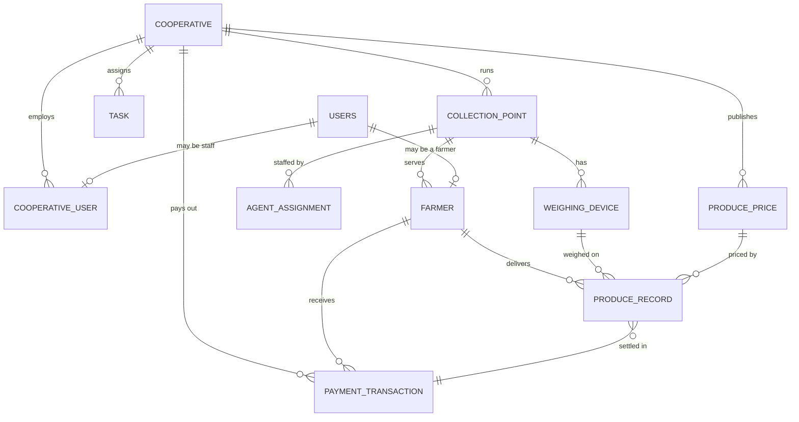

# Database

<div class="at-a-glance" markdown>

**In short:** everything belongs to a cooperative. Collection points, staff, farmers, prices, deliveries, tasks and payments all link back to one, directly or through a collection point.

</div>

## The shape of the data

One cooperative runs many collection points. Each collection point has agents, a scale, and the farmers who deliver there. A delivery joins a farmer, a weight, a price and the agent who recorded it. Payments group a month of deliveries for one farmer.



Two rules follow from that diagram and they are worth stating plainly, because they explain most of the constraints in the code:

1. **Nothing exists outside a cooperative.** Every business table carries `cooperative_id`. Every query is filtered by it. One cooperative can never see another's farmers, prices or deliveries.
2. **A delivery is the unit of truth.** Money is never stored on a farmer. A farmer's balance is always derived by summing `produce_record` rows. `payment_transaction` records the result of a payout run, not the running total.

## Main tables

| Table | Holds | Linked to |
| --- | --- | --- |
| `cooperative` | One tea cooperative | — |
| `users` | Every person: name, status and role (admin, agent, farmer) | — |
| `cooperative_user` | Staff login details: email, password hash, setup token | `users`, `cooperative`, `collection_point` |
| `collection_point` | A place where tea is weighed | `cooperative` |
| `agent_assignment` | Which agent works at which collection point | `users`, `collection_point` |
| `farmer` | A farmer and their phone number | `users`, `collection_point` |
| `weighing_device` | A scale at a collection point | `collection_point` |
| `produce_price` | Price per kilogram, with effective dates | `cooperative` |
| `produce_record` | One delivery: weight, amount, status | `farmer`, `cooperative`, `collection_point`, `weighing_device`, `produce_price`, recording agent |
| `task` | Work assigned to an agent | `cooperative`, assigned agent |
| `payment_transaction` | One farmer's monthly payment | `cooperative`, `farmer` |
| `audit_log` | A record of important actions | `users` |

### What each table enforces

The tables above hold data. These are the rules the database itself refuses to break, independent of whatever the API happens to check.

| Table | Rule | Why |
| --- | --- | --- |
| `users` | `phone_number` is unique | The phone number is how a farmer is found on USSD. Two farmers on one number is an unresolvable support case |
| `users` | `role` is one of `admin`, `agent`, `farmer` | Roles drive every permission check; a typo becomes a security hole |
| `cooperative_user` | `email` is unique | Login identity |
| `farmer` | `cooperative_id` + `phone_number` is unique | The same number cannot belong to two farmers inside one cooperative |
| `produce_price` | No two rows for one cooperative overlap in date range | A delivery must resolve to exactly one price |
| `produce_price` | `price_per_kg > 0` | A zero price would silently pay nothing |
| `produce_record` | `weight_kg > 0` | An empty delivery is not a delivery |
| `produce_record` | `status` is one of `pending`, `processed`, `paid`, `excluded` | Payment runs filter on this column |
| `produce_record` | `amount = weight_kg * price_per_kg`, computed | Stops the stored amount drifting from the inputs |
| `weighing_device` | `device_code` is unique | One code, one physical scale |
| `payment_transaction` | `cooperative_id` + `farmer_id` + `period` is unique | A monthly run can only be committed once |
| `payment_transaction` | `status` is one of `preview`, `processing`, `paid`, `failed` | Prevents double payout |

### The produce record, in detail

This is the table everything else is about, so its columns matter more than the rest.

| Column | Type | Notes |
| --- | --- | --- |
| `id` | uuid | Primary key |
| `cooperative_id` | uuid | Tenant filter, indexed |
| `farmer_id` | uuid | Indexed; payments group by this |
| `collection_point_id` | uuid | Where it was weighed |
| `weighing_device_id` | uuid, nullable | Null if the weight was entered by hand |
| `produce_price_id` | uuid | The price resolved on the day of delivery |
| `recorded_by` | uuid | The agent who saved it |
| `weight_kg` | numeric(10,2) | Two decimals; the scale reports grams |
| `price_per_kg` | numeric(10,2) | **Copied** from the price at the time of delivery |
| `amount` | numeric(12,2) | `weight_kg * price_per_kg`, computed |
| `delivered_on` | date | The local delivery date, not the timestamp |
| `status` | enum | `pending` on create |
| `created_at` | timestamptz | Set by the database |

Two of those columns exist for one reason each, and both are easy to get wrong:

- **`price_per_kg` is copied, not joined.** If it were read through `produce_price_id`, editing an old price would silently rewrite history and change what farmers were already paid. The copy makes every delivery an immutable financial fact.
- **`delivered_on` is a date, not a timestamp.** Payments group by delivery day in the cooperative's local time. A timestamp would put a 23:30 delivery into the wrong day.

!!! note "Money is stored as numeric, not float"
    `numeric(10,2)` for prices and `numeric(12,2)` for amounts. Floating point would produce totals that disagree by a cent after a few thousand rows, and a payment run that is one cent out is a support ticket in every cooperative.

## How the tables connect

- A **cooperative** owns collection points, staff, prices, tasks and payments.
- A **collection point** belongs to one cooperative and has agents, farmers, and scales.
- An **agent** is a user with the `agent` role, assigned to a collection point through `agent_assignment`.
- A **farmer** is a user with the `farmer` role, attached to one collection point, and identified by phone number.
- A **produce record** references the farmer, the collection point, the scale, the price that applied, and the agent who recorded it.
- A **payment transaction** references the cooperative and the farmer, and reports the totals for one period.

## Indexes that matter

| Index | Serves |
| --- | --- |
| `produce_record (cooperative_id, delivered_on)` | Payment period queries |
| `produce_record (farmer_id, delivered_on)` | A farmer's history, used by USSD |
| `produce_record (cooperative_id, status)` | The `pending` list a payment run picks up |
| `users (phone_number)` | USSD lookup and SMS sending |
| `farmer (collection_point_id)` | Collection point farmer lists |
| `produce_price (cooperative_id, effective_from, effective_to)` | Price resolution on save |
| `payment_transaction (cooperative_id, period)` | Preventing a duplicate run |

There is one expression index on `produce_price` that enforces the no-overlap rule with a `tstzrange` exclusion constraint. It is the only way to express "these date ranges must not overlap" in PostgreSQL without a trigger.

## Migrations

Every change to the database structure is an Alembic migration in `alembic/versions/`.

1. Change the model.
2. Generate the migration, then read it before applying it.
    ```bash
    uv run alembic revision --autogenerate -m "describe the change"
    ```
3. Check there is one head, back up the database, and apply it.
    ```bash
    uv run alembic heads
    uv run alembic upgrade head
    ```

!!! warning "Two heads"
    When two branches each add a migration, `alembic heads` shows two lines and `upgrade head` refuses to run. Join them with a merge migration:
    `uv run alembic merge -m "merge heads" <head1> <head2>`

!!! danger "Read autogenerated migrations"
    Autogenerate compares your models with the database. If a model is missing on your branch, it writes a `DROP TABLE` that deletes real data. Always read a migration before committing it.

### House rules for migrations

| Rule | Reason |
| --- | --- |
| One migration per pull request | Two reviewers can read one change; nobody can review five mixed together |
| Never edit a migration that has run on staging or production | The database records the revision; editing it means your file and the database disagree |
| Name it after the change, not the date | `add_payment_period_index`, not `update_models_2` |
| Add columns as nullable, backfill, then tighten | A `NOT NULL` column added in one step fails on a table with rows |
| Drop a column two releases after it stops being used | Gives you one release to notice nothing broke |
| Test the downgrade at least once locally | A broken downgrade is discovered on the worst possible day |

### Rollback

```bash
uv run alembic downgrade -1          # one step back
uv run alembic current               # where the database actually is
uv run alembic history --verbose     # what has run
```

Rolling back is safe for schema changes. It is **not** safe for data migrations that deleted or transformed rows — those need a backup, not a downgrade.

## Backups

| What | When | Kept |
| --- | --- | --- |
| Full logical dump | Nightly | 30 days |
| Pre-migration dump | Before every production migration | 7 days |
| Point-in-time recovery | Continuous WAL shipping | 7 days |

A pre-migration dump is taken even when the migration looks trivial. The one that looks trivial is the one that drops a column.

## Working with the database locally

```bash
uv run alembic upgrade head        # bring a fresh database to current
uv run alembic revision --autogenerate -m "change"
psql "$DATABASE_URL" -c '\dt'      # list tables
psql "$DATABASE_URL" -c '\d produce_record'   # describe one table
```

Seed data lives in `scripts/seed.py`. It creates one cooperative, one collection point, an admin, an agent, a scale and a handful of prices, so a fresh clone can record a delivery within a minute of starting.

!!! tip "Reset locally without fear"
    Local data is disposable. `uv run alembic downgrade base && uv run alembic upgrade head` gives you a clean schema in seconds. Never run `downgrade base` against any shared environment.
