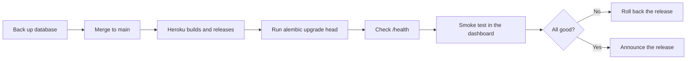

# Deployment

<div class="at-a-glance" markdown>

**In short:** work reaches `develop` only through reviewed pull requests. The backend is hosted with its settings as environment variables, and the web apps point to it through their `NEXT_PUBLIC_` variables.

</div>

## Where it runs

| Part | Hosted on | Live address |
| --- | --- | --- |
| Backend API | Heroku | Set in the apps as `NEXT_PUBLIC_API_URL` |
| Database | PostgreSQL | Used only by the backend |
| Admin dashboard | Vercel | [sulwe-dashboard.vercel.app](https://sulwe-dashboard.vercel.app/) |
| Agent app | Vercel | [sulwe-frontend.vercel.app](https://sulwe-frontend.vercel.app/) |
| Documentation | GitHub Pages | Built by GitHub Actions |

## The three environments

| Environment | Purpose | Data | Who deploys |
| --- | --- | --- | --- |
| **Local** | Everyday development | Seeded sample data, third parties mocked | Nobody — runs on your machine |
| **Staging** | Checking a release before it reaches farmers | Copy of data with names and phone numbers scrubbed | Whoever opens the release PR |
| **Production** | Real farmers, real money | Real | A named person, never automatic |

The rule that keeps this honest: **staging must never hold live credentials.** If staging can move real money through the provider, it is production with a different URL.

!!! warning "Never point a local or staging app at the production database"
    Reads are harmless until someone runs a migration or a payment run by accident. Keep `DATABASE_URL` in production settings only, and never copy it into a laptop `.env`.

## From branch to release

1. Work on a feature branch, for example `feature/payment`.
2. Merge `develop` into your branch and run every check in [Testing](testing.md).
3. Open a pull request with its checklist complete.
4. After review, it is merged into `develop`.

### Branch roles

| Branch | What may land on it | What it produces |
| --- | --- | --- |
| `feature/*` | Anything, freely | Nothing |
| `develop` | Reviewed pull requests only | A deployable build |
| `main` | Merges from `develop` at release time | Tagged release, deployed to production |
| `hotfix/*` | A single fix, branched from `main` | Back-merged into `develop` too |

### What a pull request must carry

Before the merge button is available, a PR states:

- **What changed** and which feature page under [Features](features/index.md) it touches.
- **How it was tested** — which test files were added or changed.
- **Whether it needs a migration**, and if so whether the migration is reversible.
- **Whether it changes a contract** the web apps depend on — a field renamed in a response is a breaking change even if the backend tests pass.

A PR that changes a response shape without saying so is how a dashboard breaks at 8 p.m. on a Friday.

## Backend

1. Set every backend variable from [Configuration](configuration.md) in the host's settings, never in the code.
2. Back up the hosted database, then apply migrations:
    ```bash
    uv run alembic upgrade head
    ```
3. Set `CORS_ALLOWED_ORIGINS` and `FRONTEND_URL` to the hosted web app addresses.
4. Check `https://<backend-address>/health` answers `{"status":"ok"}`.

### The order that matters

Deploying is not one action, it is a sequence, and the order is what makes it safe:



Two steps are routinely skipped and both cause incidents:

- **Back up before migrating.** A migration that drops or narrows a column cannot be undone by rolling the code back.
- **Check `/health` before opening the dashboard.** A release that failed to boot still answers the previous health check until Heroku replaces the dyno.

### Migrations in a hosted environment

```bash
uv run alembic current     # what the hosted database is on now
uv run alembic heads       # should print exactly one head
uv run alembic upgrade head
```

If `heads` prints more than one, stop. Two migration branches have diverged and running either one leaves the schema in a state no model expects. Fix it with a merge migration before deploying.

!!! danger "Never run `alembic downgrade base` on a hosted database"
    It empties the schema. On a machine with real produce records there is no undo for that beyond restoring the backup taken in step 1.

### Rolling back a backend release

| Situation | Action |
| --- | --- |
| Code is wrong, migration is fine | Heroku → *Roll back to previous release*. No database action |
| Migration is wrong but reversible | Roll back the release, then `alembic downgrade -1`, then fix forward |
| Migration is wrong and destructive | Restore the backup, roll back the release, fix forward |
| The app boots but answers 500 on one route | Roll back only if the route is critical; otherwise fix forward with a hotfix branch |

## Web apps

1. Set `NEXT_PUBLIC_API_URL` (and, for the dashboard, `NEXT_PUBLIC_PAYMENTS_API_URL`) to the hosted backend address.
2. Redeploy. `NEXT_PUBLIC_` values are built in, so a change needs a new build.
3. Open the app, sign in, and check in the browser's Network tab that requests go to the hosted backend.

### Why `NEXT_PUBLIC_` needs a rebuild

A `NEXT_PUBLIC_` variable is not read at runtime. Next.js substitutes the value into the JavaScript bundle while building. Changing it in the Vercel dashboard changes nothing until a new build runs — the old bundle still contains the old address.

That is the single most common post-deploy problem on this project, and it looks exactly like a backend outage:

| Symptom | What is actually happening |
| --- | --- |
| Requests go to `localhost:8000` | The build ran with a local `.env`. Rebuild without it |
| Requests go to an old staging URL | Value changed but no redeploy |
| Mixed — some requests right, some wrong | Two variables set to different hosts; check both `NEXT_PUBLIC_API_URL` and `NEXT_PUBLIC_PAYMENTS_API_URL` |

### Vercel environments

Vercel builds three targets from the same repository: **Production** (from `main`), **Preview** (every pull request), and **Development**. Each has its own copy of the `NEXT_PUBLIC_` variables. Setting a variable for Production only means every preview build still points at whatever Development holds.

## Payments in a hosted environment

- Point `DARAJA_RESULT_URL` and `DARAJA_TIMEOUT_URL` at the hosted backend, keeping `/api/payments/webhook?token=…`.
- Keep `DARAJA_ENVIRONMENT=sandbox` until the team decides to go live.

### Callback URLs must be reachable and public

The provider calls your backend from the outside. That has three consequences:

1. The URL must be the **public** host, never `localhost` or an internal address.
2. The `?token=…` query parameter must survive any redirect — it is how the webhook proves the call came from the provider.
3. The endpoint must answer **200 quickly**. A slow handler makes the provider retry, and a retried callback can arrive twice. Payment handling is idempotent for this reason (see [Payments](features/payments.md)).

!!! warning "Sandbox is a switch, not a habit"
    `DARAJA_ENVIRONMENT=sandbox` is safe precisely because no money moves. The danger is the reverse: a production key left pointing at a staging callback URL will take money and then fail to record it. Check both values together, not one at a time.

## This documentation site

The site is built with MkDocs and published to GitHub Pages by the `deploy-docs` workflow on every push.

```bash
mkdocs serve            # preview at http://127.0.0.1:8000
mkdocs build --strict   # check for broken links and missing pages
```

### What `--strict` catches

`--strict` turns warnings into errors, which is what makes it useful in CI rather than on a laptop. It fails the build on:

- A relative link to a page that does not exist, including the anchor inside a heading.
- A page that exists on disk but is missing from the `nav:` block in `mkdocs.yml` — it builds, but nobody can reach it.
- A duplicated anchor, which silently breaks the second link to it.
- An emoji or icon shortcode the theme cannot resolve.

Run it before every push. A broken docs link is a broken link on the page your assessor opens first.

### Publishing

```bash
mkdocs gh-deploy
```

This builds the site and force-pushes the result to the `gh-pages` branch. The workflow does the same thing on every push to `main`, so manual `gh-deploy` is only for testing.

## Deploy checklist

Run through this every time, and paste the result into the release PR:

- [ ] Every pull request in the release is reviewed and merged to `develop`.
- [ ] `mkdocs build --strict` passes locally.
- [ ] Backend tests pass, and the payment tests in particular.
- [ ] Hosted database backed up, with the backup file named in the PR.
- [ ] `alembic heads` prints one head.
- [ ] Backend variables set for the target environment.
- [ ] `NEXT_PUBLIC_` variables set for the target environment, and the app rebuilt.
- [ ] `/health` answers `{"status":"ok"}`.
- [ ] Signed in to the dashboard, and one delivery recorded end to end.
- [ ] Payment callback URLs point at the deployed host.
- [ ] Release announced in the team channel with its tag.

## Smoke test after every deploy

A health check proves the process is alive. It does not prove the system works. Ten minutes of clicking does:

1. Sign in as an admin and open the dashboard.
2. Create or open a collection point.
3. Record one delivery through the normal path.
4. Confirm the farmer received the SMS.
5. Raise one task and confirm it appears in the agent's list.
6. Open a payment preview for a small group and check the amounts.
7. Dial the USSD menu and confirm the balance option answers.
8. Sign in as an agent and confirm the app shows the right collection point.

If any step fails, the release is not done, regardless of what `/health` said.
