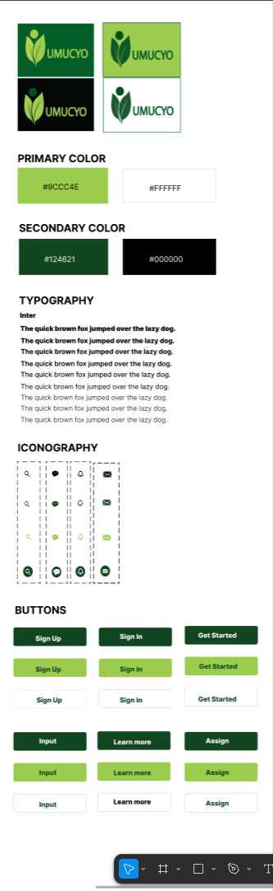
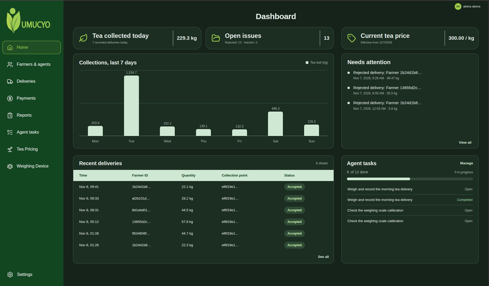
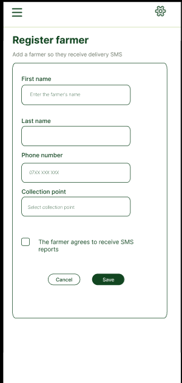

# Design System

**In short:** this page defines the visual language of the Umucyo brand and its two products — the administrator dashboard and the agent app. It is the bridge between the design files in Figma and the code in the two frontends.

**Why it exists:** so that a colour, a corner radius or a heading weight is decided once, in one place, and every screen inherits it. Consistency is cheaper than taste.

**Source files:** [Group Sulwe — Figma workspace](https://www.figma.com/design/S72ejr0O70XSSEj0ZPGrPg/Group-Sulwe?node-id=0-1&p=f&t=a7AvV946QTD2nZmJ-0)

**Screenshots:** images on this page open full size when clicked. They use descriptive filenames in `docs/assets/design/` and `docs/assets/brand/`.

This section defines the visual language for the Umucyo brand and the products built on it. It serves as the bridge between the design files in Figma and the frontend implementation. By maintaining strict adherence to these guidelines, we ensure the product remains consistent, accessible, and aligned with the cooperative's day-to-day reality in the field.

## Figma source files

All raw design assets, wireframes and final UI screens are maintained in Figma. The links below provide access to the complete workspace used by the design team.

- [Umucyo sketches and wireframes](https://www.figma.com/design/S72ejr0O70XSSEj0ZPGrPg/Group-Sulwe?node-id=0-1&p=f&t=a7AvV946QTD2nZmJ-0)
- [Product UI — dashboard and agent app](https://www.figma.com/design/S72ejr0O70XSSEj0ZPGrPg/Group-Sulwe?node-id=0-1&p=f&t=a7AvV946QTD2nZmJ-0)

!!! note "Which one wins?"
    Figma is the source of truth for **appearance**. The code is the source of truth for **behaviour**. If a screenshot here and a running screen disagree, the running screen is right and this page is out of date — fix the page. If a colour here and Figma disagree, Figma is right.

## 1. Logos

The ecosystem uses two distinct marks. **Umucyo** represents the cooperative and the platform as a whole. The **Umucyo Agent** mark is used where the product needs to be identified separately — the installable app the collection agent keeps on their phone.

### Umucyo (brand)

The primary brand logo features a geometric mark that echoes the shape of a weighing scale and the interlocking of grower and buyer, combined with the wordmark. It is set in the brand green and is the only mark used on official documents, signage and the documentation site.

### Brand logo sketches and concepts

Early iterations and conceptual explorations for the Umucyo identity.

**Brand logo ideas**

### Brand logo variations

The logo is adaptable across different backgrounds and contexts, ensuring brand recognition in all media. The variants below cover light, dark, single-colour and reversed usage.

**Brand logo variations**

### Final brand logo

The finalised, approved mark for the cooperative.

The final approved mark is shown among the logo variations in the style-guide image above.

!!! warning "Do not recolour the mark"
    The logo may appear in brand green, white (on dark) or black. It may not be tinted with any other hue, given a gradient, rotated, outlined, or placed on a busy photograph without a solid panel behind it. If a background makes the mark hard to read, use the reversed version — do not add a drop shadow.

## 2. Style guide

The style guide covers the two products built on this brand: the **administrator dashboard** and the **agent app**. They share one design language and differ only in density — the dashboard is dense because it is used at a desk with a mouse; the agent app is airy because it is used outdoors, with one thumb, sometimes in gloves.

### Typography

| Role | Face | Weight | Size | Line height | Where |
| --- | --- | --- | --- | --- | --- |
| Display / page title | Roboto | 700 | 28–32 px | 1.25 | Page headings |
| Section heading | Roboto | 500 | 20 px | 1.3 | Card and form-section titles |
| Body | Roboto | 400 | 14–16 px | 1.6 | Paragraphs, table cells |
| Label | Roboto | 500 | 12–13 px | 1.4 | Form labels, table headers |
| Numeric / tabular | Roboto Mono | 400 | 14 px | 1.5 | Weights, amounts, phone numbers |
| Caption | Roboto | 400 | 12 px | 1.4 | Timestamps, helper text |

The rule behind the table: **anything a person might read back to someone else on the phone is set in the monospace face.** Weights, amounts and phone numbers are read aloud constantly at a collection point. Monospace keeps the digits aligned in columns and stops a `0` being mistaken for an `O`.

### Colour palette

| Token | Hex | Used for |
| --- | --- | --- |
| `brand-700` | `#1B5E20` | Primary buttons, active nav, the logo |
| `brand-600` | `#2E7D32` | Hover state, links |
| `brand-50` | `#E8F5E9` | Selected rows, subtle fills, at-a-glance panels |
| `ink-900` | `#1A1A1A` | Headings and body text |
| `ink-600` | `#5F6368` | Secondary text, helper copy |
| `surface` | `#FFFFFF` | Cards, tables, sheets |
| `canvas` | `#F7F8F7` | Page background |
| `line` | `#E0E0E0` | Borders, dividers, table rules |
| `warning-600` | `#B26A00` | Pending SMS, preview states |
| `danger-600` | `#B3261E` | Failed payments, refused saves |
| `success-600` | `#1E7B34` | Paid, sent, completed |

!!! note "Check these against Figma"
    The values above match the Tailwind tokens used in the dashboard. If Figma has drifted, Figma wins — update this table and the config in the same commit, so the two never disagree by more than one pull request.

**Status colours are never used decoratively.** Green means *done*, amber means *waiting on something*, red means *needs a person*. If a screen shows red, somebody must be able to act on it. A red badge that means nothing is a support ticket waiting to happen.

### Spacing, radius and elevation

| Token | Value | Used for |
| --- | --- | --- |
| `space-1` | 4 px | Icon-to-label gap |
| `space-2` | 8 px | Inside compact controls |
| `space-3` | 12 px | Between form fields |
| `space-4` | 16 px | Card padding on the agent app |
| `space-6` | 24 px | Card padding on the dashboard, page gutters |
| `radius-sm` | 6 px | Inputs, buttons, badges |
| `radius-md` | 10 px | Cards, dialogs |
| `shadow-1` | `0 1px 2px rgba(0,0,0,.06)` | Cards at rest |
| `shadow-2` | `0 4px 16px rgba(0,0,0,.10)` | Dialogs, dropdowns |

The scale is a 4 px grid. Nothing is positioned at 5, 7 or 13 px; if a design needs an odd number, the design is working around something that should be fixed in the layout instead.

### Iconography

Icons are Material Symbols, outlined, 20 px on the dashboard and 24 px on the agent app. An icon never appears alone without a label on a destructive action — a bin with no word next to it will eventually be pressed by mistake.

## 3. Screens and components

The available images below are reference screens for the system. Each opens at full size when clicked. They are useful starting points for frontend work; verify current behavior against the running application.

!!! tip "Adding or replacing an image"
    Add the file to `docs/assets/design/` or `docs/assets/brand/`, use a descriptive filename, and update the link on this page. Export at 2× the displayed size so text stays sharp on a laptop screen or a projector.

### Component library

The pieces every screen is assembled from: buttons, inputs, selects, date pickers, badges, table rows, empty states, toasts and dialogs.

### Dashboard — overview

The first screen after sign-in. Today's deliveries, kilograms collected, tasks outstanding and the last few payments, at a glance.

### Dashboard — payments

The preview screen, where an administrator sees the amount owed per farmer before committing to a payment run.

The payment preview reference image is not included in the current documentation assets.

### Agent app — register farmer

The single form an agent fills while the farmer is standing in front of them.

### Farmer journey — USSD and SMS

The farmer's side of the system: the USSD menu on a basic handset and the confirmation SMS that follows a delivery.

See [USSD Reporting](features/ussd.md) and [SMS Notifications](features/sms-notifications.md) for the documented farmer interactions.

## 4. Product UI

### Web dashboard (administrators)

Dense, keyboard-friendly, built for a desk. Tables sort and filter without a page reload; forms validate on submit, not on every keystroke, because a red message appearing under a field the user has not finished typing reads as an error they did not make.

The dashboard is used by one or two people per cooperative, several hours a day. It may assume a large screen, a mouse and a fast connection. **The agent app may assume none of those**, which is why the two share a palette and type scale but not a layout.

### Agent app (collection agents)

Designed for one hand, outdoors, in sunlight, on a mid-range Android phone.

| Constraint | Design response |
| --- | --- |
| Bright sun | High contrast; no pale grey text on white |
| One thumb | Primary actions in the bottom third of the screen |
| Gloves, wet hands | 48 px minimum touch targets |
| Slow connection | One action per screen; explicit spinners, never an ambiguous blank |
| Interrupted work | Forms keep what was typed if the screen is closed |
| Shared devices | Sign-out easy to reach; no farmer data cached on the device |

## 5. Accessibility

- Text meets WCAG AA contrast (4.5:1 for body, 3:1 for large text). Brand green on white is checked; it passes at 16 px and above.
- Status is never carried by colour alone — every badge has a word in it (`Paid`, `Pending`, `Failed`), because colour fails for a colour-blind agent and fails again in sunlight.
- Every form field has a visible label. Placeholders are not labels; they vanish the moment typing starts.
- Focus is visible on every interactive element. Keyboard users must be able to complete a payment run without reaching for a mouse.
- Error messages say what to do, not what went wrong: *"Enter a phone number starting 07 or 01"* — not *"Invalid input"*.

## 6. Summary and implementation

The design system is only real if the code inherits it. In practice that means:

1. **Tokens live in one file.** Colours, spacing and radii are defined once in the Tailwind config and consumed by name — `bg-brand-700`, not `#1B5E20` typed into a component.
2. **One button component.** Every button on every screen comes from it. A second button implementation is how two call-to-actions end up with different corner radii.
3. **Screens are reviewed against this page.** A pull request that adds a colour or a font size outside the tables above should say why.
4. **Screenshots are refreshed, not accumulated.** When a screen changes, replace its descriptive image file rather than adding versioned duplicates; the folder is a reference, not an archive.

### Before you ship a screen

- [ ] Colours and spacing come from tokens, not literals
- [ ] Text passes AA contrast on both surfaces it appears on
- [ ] Status uses a word, not just a colour
- [ ] Touch targets are at least 48 px on the agent app
- [ ] The empty state and the error state are designed, not left to chance
- [ ] The screen at 375 px wide still works (agent app) and at 1280 px (dashboard)
- [ ] A screenshot replaces the matching `im*.png` if the layout changed

## Where to go next

- [Dashboard](frontend-dashboard.md) — the administrator app in detail
- [Agent App (PWA)](frontend-PWA.md) — the agent app in detail
- [Admin Dashboard](frontend-dashboard.md) and [Agent App (PWA)](frontend-PWA.md) — the frontend applications
- [Glossary](glossary.md) — brand, collection point, delivery, batch
