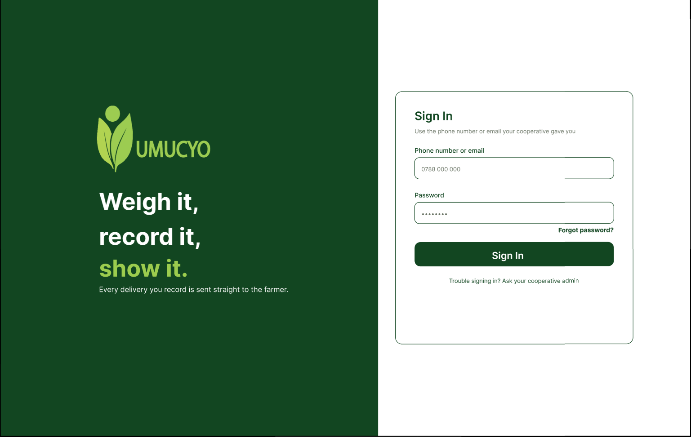
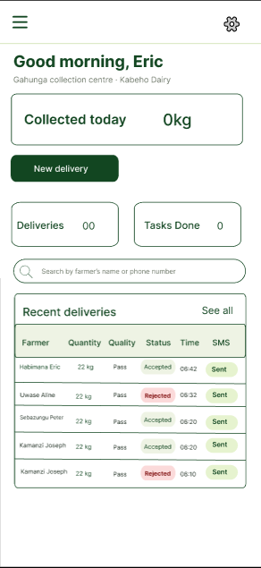
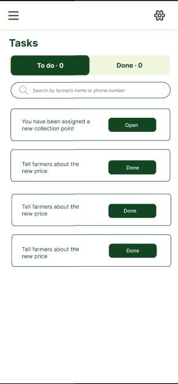
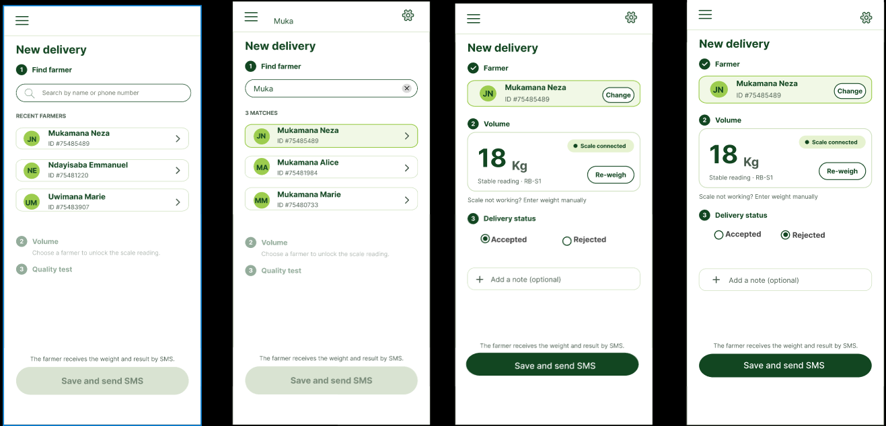
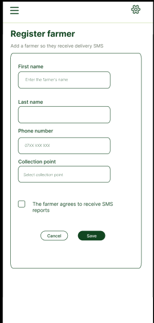

# Agent App (PWA)

<div class="at-a-glance" markdown>

**In short:** the agent app (`sulwe-frontend`) is the installable web app agents use at collection points to register farmers, record deliveries and complete tasks.

**Built with:** Next.js (App Router), TypeScript, TanStack React Query

**Who uses it:** collection agents only. Farmers use USSD and SMS; administrators use the dashboard.

**Where it runs:** any modern phone browser, or installed to the home screen, pointed at `https://sulwe-agent.vercel.app`.

</div>

[PWA — Live app](https://sulwe-frontend.vercel.app)

## What agents do in it

- See today's summary: kilograms collected, tasks done and deliveries.
- Register new farmers.
- Record new deliveries on the collection point's scale.
- Work through assigned tasks and mark them done.

Every action in the app is scoped to **one collection point** — the one the signed-in agent belongs to. An agent cannot see or touch another point's farmers, deliveries or tasks, and the backend enforces that even if the app asked for it.

## Why it is a PWA and not a native app

| Reason | What it buys us |
| --- | --- |
| One codebase | The same TypeScript skills maintain the dashboard and the agent app |
| No store review | A fix can be live in minutes, not in days |
| Always the current version | The agent has no old build to leave uninstalled |
| Installable | "Add to Home Screen" gives an icon and a full-screen window, so it feels like an app |
| Shareable login | The dashboard signs the agent in and hands over the token; no second account |

What a PWA does **not** give us: background work when the app is closed, reliable barcode or Bluetooth access on every handset, or a guaranteed offline cache. Those are the trades, and they are why the next section exists.

## Pages

| Page | Route | What agents do there |
| --- | --- | --- |
| Home | `/` | Today's totals and recent deliveries |
| Tasks | `/tasks` | To do and done tasks, with search |
| Task details | `/tasks/[id]` | Read a task's notes and mark it done |
| Register farmer | `/farmers/new` | Add a farmer to their collection point |
| New delivery | `/deliveries/new` | Record a farmer's delivery |

All agent pages share one layout: a header with the collection point's name, a sidebar with the four main destinations, and a sign-out control. There is no page in this app for prices, payments or reports — those belong to the dashboard, and hiding them from agents is a deliberate scope decision, not an oversight.

## Home

The home screen answers one question: *what is happening at my collection point today?*

| Block | Shows | Refreshes |
| --- | --- | --- |
| Today's kilograms | Sum of accepted deliveries since local midnight | On focus, and every 60 seconds |
| Today's deliveries | Count, accepted and rejected | Same |
| Tasks finished today | Count of tasks marked done today | Same |
| Recent deliveries | The last 10, newest first, with farmer name, weight, status and whether the SMS was sent | On focus |

"Today" means the local day at the cooperative's timezone, not UTC. A delivery recorded at 00:30 local time belongs to the new day even though its UTC timestamp is the previous date. The backend computes the boundary; the app only displays it.

## Tasks

Tasks are created by an administrator in the dashboard and assigned to an agent. The agent app shows only their own tasks, split into **To do** and **Done**.

- **To do** — ordered oldest first, because the oldest is the one most likely to be overdue.
- **Done** — newest first, so the last thing finished is at the top.
- **Search** — matches the task title and its notes, client-side, case-insensitive.
- **Marking done** — opens the task details, then a confirm button. The screen stays open until the server confirms; if the request fails the task stays in **To do** and an error is shown.

There is no "unassign" or "delete" in this app. An agent finishing work is the only transition here; moving a task to another agent is the administrator's job.

## Task details

Shows the title, the notes written by the administrator, when it was created and, once done, when it was completed. The notes field is read-only — agents report anything worth recording through the delivery note or by telling the administrator, not by editing the task.

## Register farmer

| Field | Required | Notes |
| --- | --- | --- |
| First name | Yes | Trimmed; 2–60 characters |
| Last name | Yes | Trimmed; 2–60 characters |
| Phone number | Yes | Rwandan format, stored normalised (`+2507XXXXXXXX`) |
| Collection point | Yes | Pre-filled with the agent's own point, editable only if the agent belongs to more than one |
| Agrees to SMS | Yes | Must be ticked; the farmer is told they will get an SMS after every delivery |

On success the farmer appears immediately in the delivery lookup. A duplicate phone number at the same collection point is refused with a clear message; the same phone number at a *different* point is allowed, because a farmer may legitimately sell at two sheds.

!!! warning "The SMS consent tick is not decoration"
    Unticking it is the only way a farmer is excluded from delivery SMS. Record it honestly — an agent ticking it on a farmer's behalf without asking is the one mistake in this screen with a legal consequence.

## New delivery

This is the screen the whole system exists for. A delivery is recorded in three steps, and each step corresponds to a real object at the shed.

1. **Find the farmer** by name or phone number. Results appear as the agent types; a farmer must exist before a delivery can be recorded.
2. **Read the weight.** With a connected scale, the stable reading appears automatically and the agent can re-weigh. If the scale is not working, the weight can be entered by hand.
3. **Choose the status**, Accepted or Rejected, add an optional note, then press **Save and send SMS**. The farmer receives the weight and result by SMS.

| Step | What the app sends | What can go wrong |
| --- | --- | --- |
| Find farmer | `GET /farmers?search=…` | No match — offer to register, don't force a fuzzy pick |
| Read weight | Nothing; the reading comes from the scale | No scale — manual entry, flagged in the record |
| Save | `POST /deliveries` with an `Idempotency-Key` | Timeout on a slow network — safe to retry, the key prevents a double record |

**The app never sends a price.** Price is resolved on the backend from the period covering the delivery date. That separation is what lets a price be corrected retroactively without touching a single delivery.

### The idempotency key

Before the save request, the app generates a key (a UUID) and holds it until the server answers. If the request times out and the agent presses save again, the same key goes with it and the backend returns the original delivery instead of creating a second one. This matters most on the poor connections collection points actually have.

### After saving

The screen closes and the agent lands back on the home summary, where the new delivery appears at the top of recent deliveries. The SMS status column shows **sent**, **pending** or **failed**:

| SMS status | Meaning | What the agent does |
| --- | --- | --- |
| Sent | The provider accepted the message | Nothing |
| Pending | Queued, provider not answered yet | Nothing yet; it updates on refresh |
| Failed | The provider rejected it or the number is unreachable | Tell the administrator; the delivery still counts |

A failed SMS never rolls back a delivery. The weight is the record; the message is a notification about it.

## Internet connection

The agent app needs an internet connection to save records. Offline saving, where records are kept on the phone and sent when the connection returns, is planned but not built yet.

Until then, the app behaves like this:

- **Reading** — the last fetched list stays on screen while the connection is down, but it may be stale, and nothing marks it as such beyond the request failing on the next refresh.
- **Saving** — the request fails and the form keeps its values, so the agent can retry without re-entering anything.
- **Signing in** — impossible while offline; the token cannot be refreshed.

!!! note "Why offline is the next real feature"
    Collection points are rural and coverage is intermittent. A queue in the browser (IndexedDB) with a replay on reconnect would make the app usable through a full outage. The `Idempotency-Key` already in the save path is the piece that makes replay safe — the reason it was built first.

## Code layout

| Folder | Holds |
| --- | --- |
| `app/` | Routes only; agent pages share one layout with the sidebar |
| `components/<feature>/` | Screens and their parts, for example `components/tasks/` |
| `components/providers/` | App-wide providers, such as React Query |
| `lib/` | Backend calls, the API helper and shared types |

The rule that keeps this workable: **`app/` holds routing, not logic.** A route file renders a component from `components/<feature>/` and passes it params. Anything longer than a dozen lines of JSX in a route file is a sign it belongs in a component.

| If you are changing… | Open |
| --- | --- |
| How a delivery is saved | `components/deliveries/` and `lib/api/deliveries.ts` |
| What the home summary shows | `components/home/` |
| The task list sort order | `components/tasks/` |
| The token, 401 handling, or base URL | `lib/api/client.ts` |
| Field labels or validation messages | `components/<feature>/` — never in `app/` |

## Signing in

Agents sign in on the same login as administrators. After login, the dashboard sends agents to this app with their token.

The flow, in order:

1. The agent opens the dashboard and enters email, password, then the 6-digit code sent by email.
2. The backend returns a token whose payload says the user's role.
3. The dashboard sees `role: agent` and redirects to the agent app with the token.
4. The agent app stores the token and adds `Authorization: Bearer <token>` to every request.
5. A `401` anywhere clears the token and returns to sign-in; a `403` shows "not allowed" and stays put.

| Token detail | Value |
| --- | --- |
| Lifetime | 24 hours |
| Refresh | None; sign in again when it expires |
| Storage | Browser storage, readable by the app |
| Signed with | `SECRET_KEY` on the backend |

!!! note "Design and current behaviour"
    The design allows signing in with a phone number or email. The current backend login (`POST /auth/login`) accepts **email** and password.

Changing `SECRET_KEY` invalidates every token at once. That is expected, not a bug: every agent is signed out and must sign in again.

## Screen designs

These are the Figma designs for the agent app. The live app follows them; small details may differ. Click any image to enlarge it.

### Sign in



The agent signs in, then enters the 6-digit code sent by email.

!!! note "Design and current behaviour"
    The design allows signing in with a phone number or email. The current backend login (`POST /auth/login`) accepts **email** and password.

### Home

{ width="300" }

Shows the agent's collection point, the kilograms collected today, today's deliveries and finished tasks, and recent deliveries with their status (Accepted or Rejected) and whether the SMS was sent.

### Tasks

{ width="300" }

Tasks assigned by the administrator, split into **To do** and **Done**, with a search box.

### New delivery



Recording a delivery takes three steps:

1. **Find the farmer** by name or phone number.
2. **Read the weight.** With a connected scale, the stable reading appears automatically and the agent can re-weigh. If the scale is not working, the weight can be entered by hand.
3. **Choose the status**, Accepted or Rejected, add an optional note, then press **Save and send SMS**. The farmer receives the weight and result by SMS.

### Register a farmer

{ width="300" }

The agent enters the farmer's first name, last name, phone number and collection point, and confirms the farmer agrees to receive SMS reports.

## When something looks wrong

| What the agent sees | Likely cause | What to do |
| --- | --- | --- |
| Signed out on every tap | Token expired, or `SECRET_KEY` changed | Sign in again; if it repeats hourly, check the backend clock |
| "Not allowed" on one page only | Role or collection point mismatch | Confirm the agent is assigned to the right point in the dashboard |
| Table is empty but no error | Genuinely no records for that filter | Try clearing the search; check the point name in the header |
| Save spins forever | Weak connection | Wait for the timeout, then press save again — the idempotency key makes it safe |
| Delivery saved, SMS "failed" | Provider rejected the number | The delivery stands; report the number to the administrator |
| Weight fields greyed out | No scale detected | Use manual entry; the record is marked as manual |
| Old data after an edit elsewhere | Query cache | Pull to refresh, or reload the app |

## Testing on a phone

```bash
cd ~/sulwe-frontend
pnpm install
cp .env.example .env.local     
pnpm dev --hostname 0.0.0.0 --port 3000
```

Then open `http://<your-laptop-ip>:3000` on a phone on the same Wi-Fi. `--hostname 0.0.0.0` is the part people forget; without it the dev server only answers on `localhost`.

To try install behaviour, open the site in Chrome on Android or Safari on iOS and use **Add to Home Screen**. Test the full-screen window, not just the browser tab — safe-area insets on notched phones are the thing that usually needs fixing.

## Before you open a pull request

- [ ] `pnpm lint` and `pnpm build` both pass
- [ ] The page still works with the network throttled to Slow 3G
- [ ] Saving a delivery twice does not create two records
- [ ] No `NEXT_PUBLIC_*` value was read outside `lib/`
- [ ] A failed request shows a readable message, not a blank screen
- [ ] Screens still match the design at 360 px wide
- [ ] Any change to a response shape was made in the shared types in `lib/`
