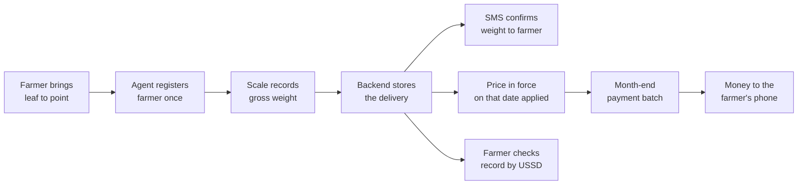

# Overview

**In short:** Umucyo is a digital platform that helps tea cooperatives manage tea
collection, keep accurate records of farmers and their deliveries, and pay farmers
every month.

**Who it is for:** one cooperative at a time — an administrator at a desk, agents at
collection points, and farmers with basic phones.

**What it replaces:** paper delivery books, a spreadsheet of prices, and a month-end
reconciliation done by hand.

[Research documents](https://docs.google.com/document/d/1cbp5ZLpnKRwbxdVs_UX9hdPlw-m48xILkFQKycABkrU/edit?usp=sharing)

## The problem

Tea cooperatives collect green tea leaves from many farmers at several collection
points. Farmers are paid by the weight they deliver, so every weight, price and
payment has to be accurate and traceable. Paper records and informal messages make
that hard: deliveries get lost, prices are unclear, and farmers have little
visibility into what was recorded for them.

### What that looks like in practice

A delivery book at a collection point records a name, a weight and a date. It does
not record which scale was used, whether that scale had been calibrated, which agent
was on duty, or what the price per kilogram was on that day. Weeks later, when a
farmer disputes a payment, none of those questions can be answered from the book.
The honest answer is usually "somewhere between these two numbers".

Three specific failures follow from that:

| Failure | How it shows up | Cost |
| --- | --- | --- |
| **Lost deliveries** | A page is torn, a book is left at the wrong point, a name is written in a way nobody can match later | A farmer is not paid for work already done |
| **Unclear prices** | The price changes mid-month but nobody wrote down the exact date it changed | Two farmers with identical deliveries are paid differently, and neither can be explained |
| **No visibility** | A farmer has no way to check their own record without travelling to the point and asking | Disputes become conversations about trust instead of about records |

### Why a spreadsheet does not fix it

A spreadsheet is often the first attempt, and it fails for structural reasons rather
than lazy ones. Anyone with the file can edit any row, nothing records who changed
what, two people cannot safely enter deliveries at the same time, and there is no
link between a delivery and the payment that settled it. The information is there,
but it cannot be trusted enough to pay from.

### Why a phone menu, not an app, for farmers

Most farmers do not carry a smartphone. Requiring one would exclude the people the
system exists for. That single constraint explains several decisions elsewhere in
this documentation: why farmers interact through USSD and SMS, why delivery
confirmations are short enough to read on a small screen, and why the agent app is
built to work on a cheap Android phone with a poor connection.

## What Umucyo does

- Registers the people involved in a controlled way: administrators, agents and farmers.
- Records every delivery against a verified scale, a collection point and the agent who weighed it.
- Calculates the amount owed from the weight and the official price per kilogram.
- Pays farmers monthly through M-Pesa.
- Keeps farmers informed by SMS, and gives them access to their information by USSD from any basic phone.
- Lets administrators assign and track work for their agents.

Each of those is a feature with its own page. Stated as a chain, they describe one
delivery from field to payment:

### The rules the system holds to

Four rules run through every feature. They are stated here because they explain
behaviour that otherwise looks arbitrary.

| Rule | What it means | Where you will see it |
| --- | --- | --- |
| **The device is the record** | A weight comes from a registered scale, not from a typed number | Deliveries cannot be edited after they are saved |
| **The price is a period** | A delivery is valued at the price in force on its own date, not at today's price | Prices are stored as date ranges that may not overlap |
| **Retrying is safe** | Sending the same request twice cannot create two records | A dropped connection mid-save is never a double delivery |
| **Every query is scoped** | Each record belongs to exactly one cooperative and is never visible across that line | An agent sees only their own collection point |

## Who uses it

| User | Uses | Main jobs |
| --- | --- | --- |
| Cooperative administrator | Admin dashboard (web) | Manage collection points, agents, devices, prices and tasks; pay farmers |
| Collection agent | Agent app (installable web app) | Register farmers, record deliveries, complete tasks |
| Farmer | Basic phone (SMS and USSD) | Receive delivery confirmations, check reports |

### The same system, seen from three sides

**The administrator** works at a desk and cares about the month: are all deliveries
in, is the price right, did every farmer get paid, and who is still owed money. The
dashboard is built for reading and deciding, so it favours tables, totals and a
preview before anything irreversible happens.

**The agent** works standing up, often outdoors, with one hand free. The app is built
for doing: large buttons, few fields, a save that survives a weak signal, and a clear
statement of what the farmer will receive by SMS.

**The farmer** holds a basic phone and wants three answers: what did I deliver, what
is it worth, and when do I get paid. Anything longer than a few lines of SMS will not
be read on a small screen.

## What Umucyo is not

Saying what a system does not do prevents a great deal of confusion later.

- **Not an accounting package.** It records what is owed and what was paid. It does
  not produce a full set of financial statements.
- **Not a farm-management tool.** It does not record planting, weeding, fertiliser or
  yield per plot. It starts at the collection point.
- **Not a public service.** There is no farmer sign-up and no public price page.
  Access is by invitation and by phone number.
- **Not multi-cooperative by default.** One deployment serves one cooperative. The
  records are scoped so that the boundary is real, not so that several co-ops can
  share an account.
- **Not an offline-first system.** The agent app tolerates a brief drop, but it needs
  a connection to confirm a delivery. Background syncing is not built.

## Where the system is heading

The roadmap is not a promise, but it sets the direction of the work:

| Area | Next step | Why it is next |
| --- | --- | --- |
| Offline | Queue deliveries while disconnected, send when signal returns | Agents work in places where signal is unreliable |
| Payments | Reconciliation report from the provider, not only from our own records | The failure that matters is paying twice or not at all |
| Reporting | Monthly yield per farmer and per point | The cooperative currently builds this by hand |
| Devices | Calibration log per scale | A disputed weight is a trust problem |

## Words you will meet

A few terms recur throughout this documentation and are worth fixing early:

- **Collection point** — where tea is brought and weighed.
- **Produce record / delivery** — one weighing of one farmer's leaf; the same thing.
- **Price period** — the date range a price applies to.
- **Batch** — the group of payments prepared together for one month.
- **PWA** — the installable web app the agent uses.

The [glossary](glossary.md) defines the rest.

## Where to go next

- [Getting started](getting-started.md) to run the system on your computer.
- [Architecture](architecture.md) to see how the parts fit together.
- [Features](features/index.md) for how each part of the system works.
- [Glossary](glossary.md) when a word in another page is unfamiliar.

If you are reading this as an assessor or a new team member, the shortest path is
Overview → Getting started → Architecture, then the feature page for whatever you
have been asked about.
